# Meerkat

每日 AI 情报简报桌面端。从 35 个公开信号源聚合，用 AI 写成中文简报。

- 设计：[DESIGN.md](DESIGN.md)
- 架构：[ARCHITECTURE.md](ARCHITECTURE.md)
- 品牌：[brand/BRAND.md](brand/BRAND.md)
- 实现计划：三阶段（自用 → 可分发 → 反馈迭代）

---

## 当前进度

| 里程碑 | 状态 |
|---|---|
| P1-0 骨架 + better-sqlite3 验证 | ✅ 完成 |
| P1-1 数据层（6 表 + 迁移 + 仓储 + FTS5） | ✅ 完成（24 测试通过） |
| P1-2 引擎移植（归一/去重/分类/打分 + 8 类抓取器） | ✅ 完成（51 测试 + 黄金对照 + 真实网络跑通） |
| P1-3 简报生成（DeepSeek + 链接校验 + 降级） | ✅ 完成（真实生成 24 条，链接 32/32） |
| P1-4 阅读界面（解析 + 卡片 + 键盘导航） | ✅ 完成（77 测试，界面已截图验证） |
| P1-5 源管理 + 健康看板 + 首启引导 | ✅ 完成（86 测试，界面已截图验证） |
| P1-6 托盘 + 定时 + 通知 + 导出 | ✅ 完成（105 测试） |
| P2-1 打包分发（portable + zip） | ✅ 完成（打包后自检通过） |
| P2-3 崩溃日志 + 诊断包（脱敏） | ✅ 完成（19 测试专注脱敏） |
| P2-4 已读/收藏持久化 | ✅ 完成（10 测试，端到端链路） |
| P2-5 跨天去重 + 覆盖保护 | ✅ 完成（16 测试 + 连跑两次实测） |
| P2-6 源管理增删 + 时间线 | ✅ 完成（18 测试） |
| P2-7 API Key 管理（加密存储 + 一键导入） | ✅ 完成（11 测试） |
| **P2-8 开机自启（重启后仍能自动跑）** | ✅ 完成（真机验证 Run 键） |
| **P2-9 全文检索界面** | ✅ 完成（真机搜到 5 条真实结果） |
| **P2-10 编辑已有源** | ✅ 完成（11 测试） |
| **P3 反馈渠道 + 快速修复流程** | ✅ 完成（13 测试 + docs/FEEDBACK.md） |
| **P4 和昨天比（对比视图）** | ✅ 完成（9 测试，界面已截图验证） |
| **P5 多主题（各自源集合 / 排程 / 简报）** | ✅ 完成（18 测试，真机验证过切换隔离） |
| **工程债清零（组件测试 / 日志按天 / 重复依赖）** | ✅ 完成（+17 测试） |
| **手动触发：重新成稿 + 可取消** | ✅ 完成（真机验证取消与重写） |
| **AI 对话 P0（浮层 + 上下文 + 模型切换）** | ✅ 完成（真机跑通总结/取消） |
| 真机验证（窗口/托盘/通知/关窗/打包版） | ✅ 完成（详见 docs/VERIFICATION-RESULT.md） |

> **Electron 版本**：项目用 **38.8.6**，不是最新的 45。
> 45.1.0 在开发机上必崩（`0xC0000005`，最小应用也复现），38 正常。
> 这是唯一一处为了"能跑"而做的降级，记录在验收文档里。
>
> **真机已验证**：窗口、托盘图标进通知区（bounds 非零）、系统通知可用、关窗收进托盘、
> 开机自启写入注册表、到点自动触发完整链路、三种产物（开发态/解压版/便携版）都能启动。

**视觉规范见 [docs/VISUAL-WORLD.md](docs/VISUAL-WORLD.md)** —— 晨光报纸（版式）+ 靛蓝（强调），
含完整色值、对比度实测与"明确不做"清单。

**剩余待办见 [docs/TODO.md](docs/TODO.md)** —— 按"阻塞在外部条件 / 未验证 / 功能缺口 / 工程债"分类，
每项都写了为什么卡住和怎么算做完。

---

## 快速开始

```bash
pnpm install
pnpm rebuild:native     # 装完必须重编 better-sqlite3（见下）
pnpm dev                # 开发模式
pnpm build              # 构建到 out/
pnpm typecheck
pnpm prep-schedule 2    # 把排程拨到 2 分钟后（验收定时触发用）
```

本机 pnpm 不在 PATH，用：

```powershell
$node = "C:\Users\husle\.dsh\dsh-runtimes\dsh-primary-runtime\dependencies\node\bin\node.exe"
$pnpm = "C:\Users\husle\.dsh\dsh-runtimes\dsh-primary-runtime\dependencies\pnpm\bin\pnpm.mjs"
& $node $pnpm install
```

---

## 三个必须记住的环境坑（实测踩过）

### 1. `ELECTRON_RUN_AS_NODE=1` 会让 Electron 退化成纯 node

环境里默认设了这个变量。后果：`require('electron').app` 为空，脚本报
`Cannot read properties of undefined (reading 'disableHardwareAcceleration')`。

**任何直接调 electron 的脚本，都要先删掉这个变量。** `scripts/run-electron.cjs` 已经处理了。

### 2. 从 PowerShell 直接 `& electron.exe script` 会 0xC0000005 崩溃

必须：`--no-sandbox` + 用 `Start-Process`/`spawn` 做 stdout/stderr 重定向。
`scripts/run-electron.cjs` 已封装。

### 3. better-sqlite3 必须按 Electron 的 ABI 重编

Electron 45 的 ABI 是 **150**，Node 24 是 137，直接 `pnpm install` 拿到的二进制会段错误（0xC0000005）。

装完依赖后必须跑 `pnpm rebuild:native`（即 `electron-rebuild -f -w better-sqlite3`）。
需要 VS 2022 + Python，本机都有。

**验证方式**：`pnpm verify:sqlite` → 看 `scripts/verify-result.json` 里 `"ok": true`。

---

## 已验证的能力

### P1-0 · better-sqlite3（`pnpm verify:sqlite`）

```
better-sqlite3 加载  ok
journal_mode         wal
sqlite_version       3.53.4
schema               table + index + fts5 + trigger
fts_match            Gemini 4 Carbon 发布
fts_trigger_rows     3
fts_chinese_match    1
user_version         3
```

### P1-1 · 数据层（`pnpm test`）

24 个测试覆盖：迁移幂等、源健康度（成功清零失败计数 / upsert 不覆盖计数）、
条目 upsert 不重复、外键级联、**中文 trigram 子串检索**（含跨词命中）、
短查询 LIKE 兜底、增量 briefed 标记、briefs/runs/settings 读写。

搜索用 `tokenize='trigram'` 而不是默认的 `unicode61`：
后者对中文只能整词命中（"上下文"能搜到，但"前沿模型"搜不到摘要里的"前沿模型登顶"）。

### P1-2 · 引擎移植（`pnpm test` / `pnpm run-once`）

**黄金对照**：用 Python 原型真实跑出的 80 条数据（`tests/fixtures/python-items.json`）
逐条比对，**分类 80/80 命中、分数误差 <0.01**。这是移植正确性的硬证据。

**真实网络跑通**（34/35 源成功，约 30 秒）：

```
原始条目 170 条 → 去重截断 80 条 → 落库 → FTS 可检索
板块分布：产品 27 / Agent 14 / 商业 12 / 研究 9 / 社区 6 / 观点 5 / 算力 4 / 政策 2 / 视频 1
```

移植过程中修掉的 5 个真实 bug（都写进了代码注释）：

| 现象 | 根因 |
|---|---|
| arXiv 恒为 0 条 | `undici.request()` 不支持 `maxRedirections`，301 重定向拿到空 body → 改用 `fetch` |
| DeepMind 的 XML 解析失败 | 请求了压缩但未解压，把二进制丢给 XML 解析器 |
| HF 热榜 0 条 | Next.js 把 JSON 引号转义成 `&quot;`，没还原就切不出块 |
| Top10 被无关仓库霸占 | `REPO_TERMS` 里的 `ai` 没有词边界，`jailbreaks`/`maintain` 都命中 |
| 两个 Reddit 子版同时 429 | 各自 sleep 后会同时发车 → 改为按 host 串行限速 |

**已知降级**：`r/MachineLearning` 长期 429（Reddit 对本机 IP 限流），属可接受损失。

### P1-3 · 简报生成（`pnpm compose-once`）

真实调用 DeepSeek 的完整链路（约 70 秒、9.2k 输入 / 13k 输出 token）：

```
条目 80 条 → 模型成稿 → 24 条精选 → 链接校验 32/32 = 100% → 落库 + 写 out/AI简报-YYYY-MM-DD.md
```

**两道防线**：
1. **链接强校验**：模型输出的每个 URL 必须逐字出现在素材里，命中率 <85% 判失败并列出可疑链接
2. **统计不交给模型**：源数量、成功数、健康度表、精选条数全部由程序追加

**降级是一等形态**：没有 API Key 或模型失败时，仍产出"仅聚合"简报（按板块列条目 + 链接），
不会因为模型不可用而什么都拿不到。

**踩到的坑**：首次生成时简报缺了「今日一句」——模型输出被 `max_tokens` 截断
（13977 输出 token），但适配器只判了"正文为空"，把截断当成了成功。
现在通过 `finish_reason === 'length'` 检测截断，并做结构校验（缺「今日一句」「三句话速览」都会报 issue）。

### 导出：Markdown / HTML / PDF / 富文本

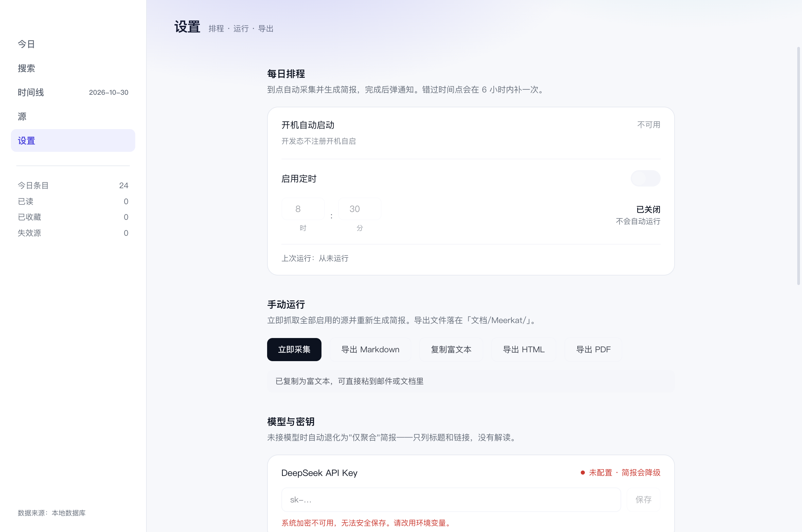

四种格式共用一份 HTML：渲染层用 `parseBrief` 的结果渲染（解析器只有一份），主进程只负责落地。

- **HTML**：自带样式，发给别人双击就能看
- **PDF**：隐藏窗口 `printToPDF`，排版与 HTML 完全一致；中文用系统字体，链接保留为 PDF 注解
- **富文本**：同时写 `text/html` 与 `text/plain`，粘到邮件/Word 里保留标题层级
- **Markdown**：原有通道，写 `.md` 到「文档/Meerkat/」

为什么不在主进程引 markdown 库：那样 PDF 和界面会各有一套"什么叫一条简报"的定义，
模型换了写法之后，两边必然只有一个是对的。

### P1-4 · 阅读界面

界面从 markdown 派生，不额外维护一份 IR（markdown 是唯一真源，见 `src/renderer/src/lib/parseBrief.ts`）。
渲染层在没有 Electron 时自动回退到内置样例，所以**同一份 UI 代码在浏览器里也能截图验证**——本机无法启动
Electron 窗口，这条回退是能在开发机上验证 UI 的唯一途径。

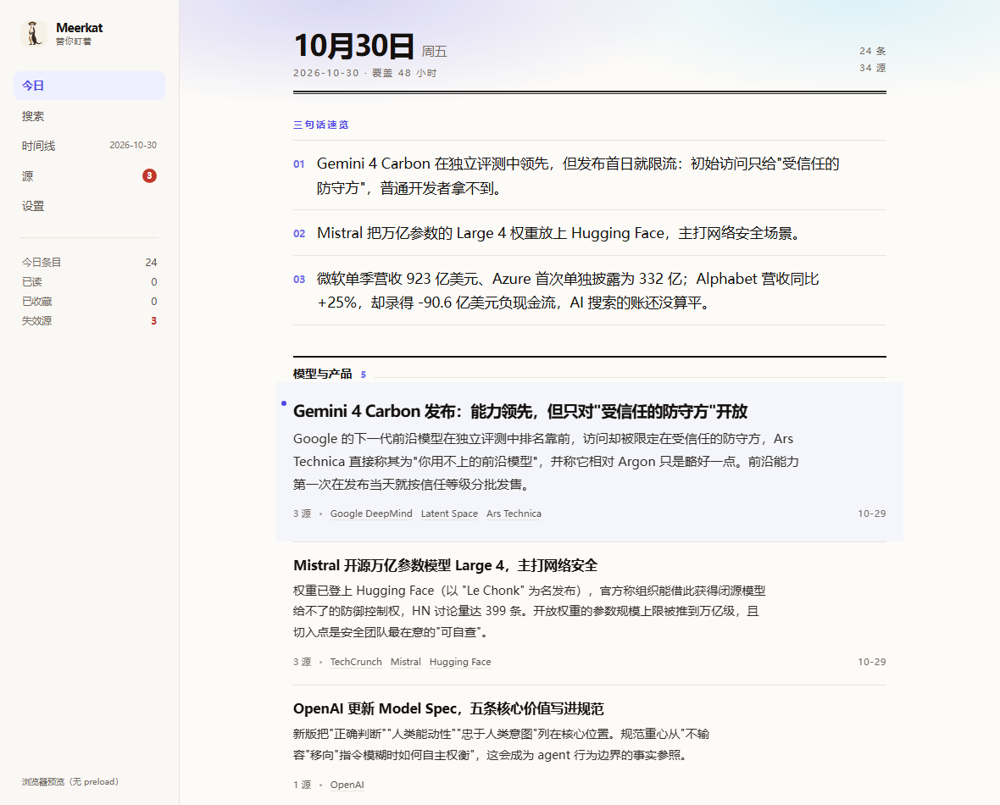

**键盘模型**（照抄 vim/邮件客户端）：`j`/`k` 上下、`g`/`G` 首尾、`s` 收藏、`o` 打开、`h` 隐藏。
设计目标是"5 分钟读完"，用鼠标滚轮逐条扫是最大的损耗。

这套状态机现在有 **9 个 jsdom 组件测试**（`tests/brief-view.test.tsx`）：j 到底后不越界、
k 在首条停住、G/g 跳转、h 隐藏后能从 DOM 里消失并且能恢复、o 同时开原文与标已读、
输入框聚焦时不抢键。以前这些只有截图，截图证明不了"按 j 到底有没有越界"。

**颜色纪律**：橙色只出现在两处——选中态指示条、侧栏"失效源"角标。
品牌规则是"橙色出现频率 <5%，否则警报就不算警报"。

### P1-5 · 源管理与健康看板

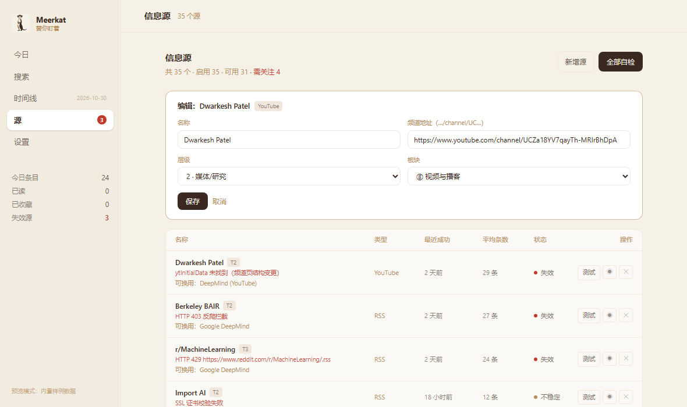

**三态健康模型**（`src/app/source-health.ts`，纯函数、9 个测试）：

| 状态 | 条件 | 界面 |
|---|---|---|
| 正常 | 连续失败 0 次 | 墨色点 |
| 不稳定 | 连续失败 1–2 次 | 焦糖色点 |
| 失效 | 连续失败 ≥3 次 | 红点 + 错误原因 + **可换用建议** |

**排序规则**：坏源排最前（`sortByHealth`）。打开这一页的人 90% 是来修东西的，
把健康源列在前面是浪费他的注意力。

**全量自检**：35 个源并发 6 个跑，每完成一个通过 `sources:progress` 事件推一次进度——
用推送而不是让渲染层轮询，因为自检本身可能 60 秒以上。

**IPC 边界的三条纪律**：
1. 渲染进程只能通过 preload 暴露的窄接口访问数据，不碰 `fs`/`require`/`ipcRenderer`
2. 所有入参在主进程侧用 zod 校验（渲染进程可被 XSS 影响，不能信任）
3. handler 返回 `{ ok }` 形状，不把异常抛给渲染层

**踩到的坑**：`window.meerkat` 的类型声明一度出现在两个文件里（P1-4 和 P1-5 各写了一份），
TypeScript 报 TS2717 "Subsequent property declarations must have the same type"。
现在统一收口在 `src/renderer/src/lib/ipc-types.ts`，全项目只有一处 `declare global`。

**首启引导**：三步（选领域 → 确认源 → 接模型），第 3 步允许跳过。
把"要不要花钱"推迟到用户已经看到价值之后——这是从 Python 版继承的产品判断。

### P1-6 · 托盘 + 定时 + 通知 + 导出

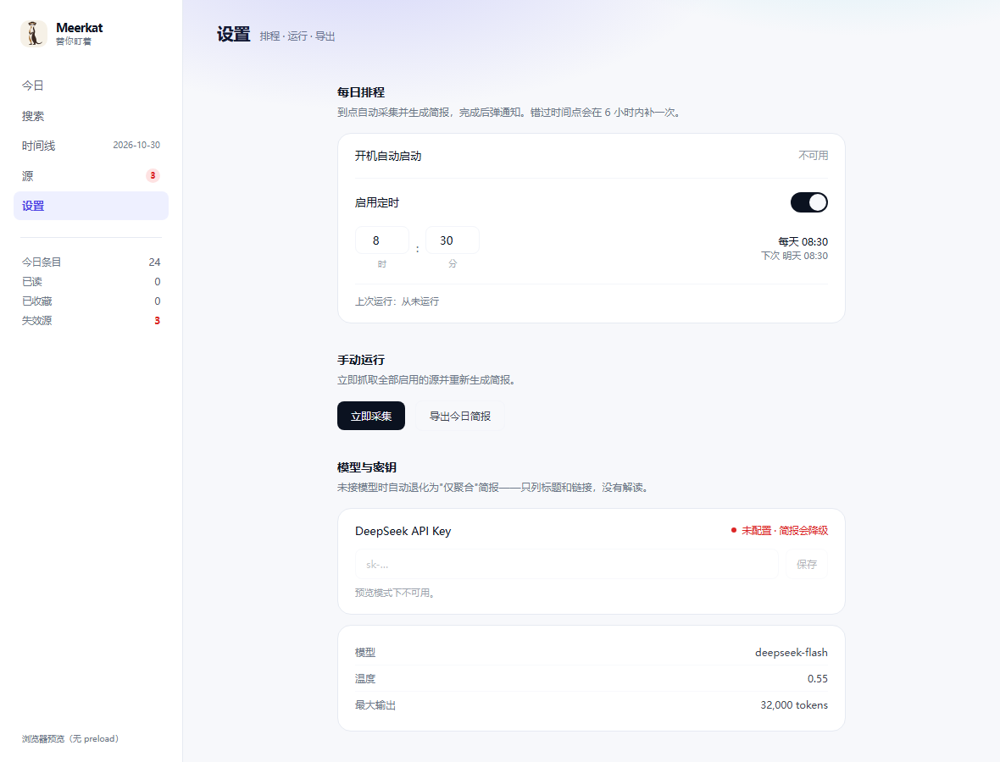

**关窗 = 收进托盘，不是退出。** 这是"无人值守"的前提：
`window.on('close')` 里 `preventDefault()` + `hide()`，只有托盘菜单"退出"才真正 `app.quit()`。

**排程是纯函数**（`src/app/schedule.ts`，19 个测试）。定时逻辑的错误（差一小时、跨夜、
休眠后重复触发）在真机上极难复现，写成纯函数后可以穷举测出来。三个必须处理的场景：

| 场景 | 行为 | 测试锁住 |
|---|---|---|
| 正常到点 | 触发一次 | `scheduled` |
| 关机错过（≤6h） | 开机补跑**一次**，不连补多天 | `catch-up` + "补跑只补最近一个点" |
| 错过太久（>6h） | 不补跑，等下一个点 | `too-late` |
| 今天已跑过 | 不重复触发 | `already-ran` |

**采集只有一份实现**：`src/app/run-collect.ts`。手动"立即采集"、定时任务、
`pnpm run-once` 脚本全都调用它——两套实现必然漂移，漂移出来的差异最难查。

**导出**：写到 `文档/Meerkat/AI简报-YYYY-MM-DD.md`，并在资源管理器里定位文件。

**盘中/托盘图标**：≤24px 用单独画的字形（`icon-meerkat-head-16.png`：头 + 一道眼罩），
不要把 512 主标缩到这一档——缩下去会糊成一块（见 `brand/BRAND.md`）。

---

## P1 完成情况

三个阶段的验收线是"我自己能连续用起来"。当前状态：

```
采集 34/35 源（r/MachineLearning 被 Reddit 限流，已知降级）
  → 归一/去重/打分（与 Python 原型黄金对照 80/80 一致）
  → 80 条候选
  → DeepSeek 成稿 24 条（链接校验 32/32 = 100%）
  → 落库 + 界面可读 + 可导出
  → 每天 08:30 自动运行，完成后弹通知
```

**105 个测试**，7 个测试文件：

| 文件 | 覆盖 |
|---|---|
| `store.test.ts` | 数据层、迁移幂等、FTS5 中文子串、外键级联 |
| `pipeline.test.ts` | 归一/分类/打分/去重/编排 |
| `golden.test.ts` | **与 Python 原型逐条对照**（分类 80/80、分数 <0.01） |
| `compose.test.ts` | 链接校验、降级、版式归一 |
| `parse-brief.test.ts` | 简报解析（含异常输入不白屏） |
| `source-health.test.ts` | 三态健康模型、排序、替代建议 |
| `schedule.test.ts` | 排程、补跑、跨日跨月跨年 |

### P1 之后还没做的（有意留到 P2）

- 打包分发（NSIS / `.ico` / `.icns` / 自动更新）
- 时间线页（数据层已支持 FTS5，界面未做）
- 已读/收藏状态持久化（当前只存在页面内存里）
- 崩溃日志与诊断包
- 密钥迁移到 `safeStorage`（当前从环境变量或 `~/.dsh/.credentials.yaml` 读取）

---

## P2-1 打包分发

### 产物

| 文件 | 大小 | 说明 |
|---|---|---|
| `release/Meerkat-0.0.1-x64.zip` | 161.8 MB | 解压即用 |
| `release/Meerkat-0.0.1-便携版.exe` | 116.2 MB | 单文件便携版，双击运行 |
| `release/win-unpacked/` | 403.4 MB | 未压缩目录（排查用） |

`npm run dist` 出前两个，`npm run dist:dir` 出目录。

### 打包后自检（`pnpm verify:packaged`）

用 `ELECTRON_RUN_AS_NODE` 在**打包后的运行时**里跑脚本，验证最容易出错的四项：

```
electron: 45.1.0  node: 24.22.1  modules(ABI): 150
app.asar 内 out/main、out/preload、out/renderer 齐全
extraResources 落地正确（resources/sources.json、prompts、brand 图标）
better-sqlite3 从 asar 加载成功 · sqlite 3.53.4 · 中文写入读出 ok · FTS5 可用
```

这条自检比"能启动"更有价值：`better-sqlite3` 是原生模块，asar 打包后如果没解包，
表现是启动即崩，而在开发态完全正常——最容易漏测的一类问题。

### 三个必须配对的设置

| 设置 | 值 | 不配的后果 |
|---|---|---|
| `asarUnpack` | `**/node_modules/better-sqlite3/**` | 原生 `.node` 在 asar 里无法 dlopen，启动即崩 |
| `extraResources` | `resources/`、`brand/` | 打包后读不到 prompt 与 35 个源配置 |
| 路径解析 | `src/main/paths.ts` | 开发态 `app.getAppPath()`，打包后 `process.resourcesPath` |

### NSIS 安装包在本机不可用（已知限制）

`nsis` 目标失败，报 `process failed 2`。根因已定位：electron-builder 生成卸载器时，
会用 makensis 打一个 `-DBUILD_UNINSTALLER` 的特殊安装包，然后**执行它**来产出
`Setup.__uninstaller.exe`。这台机器的实时防护会拦下这个刚生成、未签名的可执行文件。

无法在本机绕过的两条路：买代码签名证书，或在无实时防护的环境打包。
所以默认产物切换成 `portable` + `zip`——它们不需要执行任何东西。
`electron-builder.yml` 里的 `nsis` 配置保留着，换机器后加回 `win.target` 即可。

### 未验证的部分

打包后的**图形界面没跑起来过**（本机 Chromium 无法初始化，`whenReady()` 直接崩）。
已验证的是数据层与文件布局。托盘、通知、定时、窗口行为需要你在真机上确认。

---

## P2-3 崩溃日志 + 诊断包

### 日志（`src/main/log.ts`）

写到 `userData/logs/main-YYYY-MM-DD.log`，**按天分文件、保留 7 天**；单日超过 2MB 再轮转一份
（`main-YYYY-MM-DD.1.log`）。诊断包读日志尾部时会先读今天、不够再往前一天，
这样跨天之后仍能看到昨夜失败的那几行。

命名与保留策略抽在 `log-files.ts`（纯函数，8 个测试）：`2026-13-40` 这种能被 `Date` 正常化的
假日期会被拒绝——否则清理逻辑会拿一个不存在的日期去算年龄。

三个约束：

1. **写日志绝不抛异常**——否则错误处理本身会把应用搞崩
2. 崩溃钩子覆盖 `uncaughtException`、`unhandledRejection`、
   `render-process-gone`、`child-process-gone`
3. 不引 winston/pino：多一个依赖就多一个打包风险（这个项目已经在原生模块上踩过）

### 诊断包（`src/app/diagnostic.ts`）

用户点一下导出，得到 `文档/Meerkat/Meerkat-诊断-<时间>.json`：版本、Electron/Node 版本、
schema 版本、源健康度、最近 5 次运行、日志尾部 300 行。

**核心是脱敏**，因为诊断包会被贴进聊天窗口和 issue：

| 泄露形态 | 处理 |
|---|---|
| `sk-xxxx` | `sk-***REDACTED***` |
| `Authorization: Bearer xxx` | 保留认证类型，凭证打码 |
| `api_key= / token: / secret= / password=` | 值打码 |
| 邮箱 | `***@***` |
| 32 位以上十六进制串 | `***HASH***` |
| 路径里的用户名 | `C:\Users\zhangsan\...` → `~/...` |

这条逻辑做成纯函数并用 **19 个测试**穷举泄露场景。理由：一旦泄露一次，
这个功能就永久失去信任，用户下次不会再点。

其中一条测试是"整个包里搜不到任何密钥形态"——把整份 bundle 序列化后整体扫一遍，
而不是逐字段检查。逐字段检查会漏掉新增字段。

---

## P2-4 已读/收藏持久化

之前的状态只存在 React state 里，**刷新就丢**——界面上的"已收藏"是假的。

### 难点：简报里没有条目 id

`items` 表有 id，但简报正文只有 URL。所以链路是：

```
简报 markdown → 解析出条目 → 用链接反查 urlToId → 得到 items.id → 写 item_flags
```

反查用**第一个能对上源的链接**，因为模型常把同一事件的多条素材合并成一条
（官方博客 + HN 讨论），任一链接命中即视为同一条。

映射失败时退化为"仅本次会话有效"，不崩、不阻塞阅读。

### 数据层

`item_flags` 表：`is_read / is_saved / is_hidden / briefed_at / noted_at`。
三个布尔位是独立的，不是互斥状态——一条内容可以既已读、又收藏、还进过简报。

### 测试覆盖

10 个测试，包括：

- 跨会话持久化（写入 → 重开 → 仍在）
- 部分更新不清掉其他字段
- 取消收藏是显式写 `false`，不是删行
- 条目删除时标志位级联清掉
- **端到端链路**：真实简报 24 条 → 反查 id → 标记 → 重读，读回一致的计数

### 顺手修掉一处不诚实的文案

设置页原来写"密钥存储：系统钥匙串（safeStorage）"——实际实现是从环境变量或
`~/.dsh/.credentials.yaml` 读。现在改成真实描述。界面不该撒谎。

---

## P2-5 跨天去重 + 覆盖保护

这两条都属于"不做也不会报错、但会慢慢毁掉体验"的问题。

### 跨天去重

48 小时窗口天然重叠，昨天推过的新闻今天会再推一遍。现在：

```
成稿里被引用的条目 → markBriefed → 下次生成时过滤掉
```

**只有真正写进简报的才标记**。模型看过但没采用的条目留到明天——
否则一次没选中就永久消失，等于浪费了抓取成本。

**保护性回退**：如果过滤后少于 `max(8, 总数 30%)`，放弃过滤。
宁可重复，也不交一份几乎空的简报。

实测（连跑两次）：

```
第一次  183→80 条  标记已推送 33
第二次  去重丢弃 33  再标记 24  落库 replaced
```

### 覆盖保护

同一天的简报按日期为主键，写入是 `ON CONFLICT DO UPDATE`。
问题：上午生成好简报，下午手滑点"立即采集"、恰好模型超时，
**降级版会把好版本覆盖掉且无法恢复**。

现在 `decideSave` 规定：**降级版不得覆盖非降级版**
（降级版的特征是 `model === 'none'`）。反过来，正常版可以替换降级版，记为 `upgraded`。

这条没做成配置项——没有人会希望自己的好数据被坏数据冲掉。

---

## P2-6 源管理增删 + 时间线


**新增源**：名称、地址、类型（RSS / Atom / HTML / YouTube / arXiv / HN / GitHub / HF）、
层级、板块。校验规则与主进程共用同一份纯函数（`src/app/source-edit.ts`），
避免"界面放行、主进程拒绝"。

几个细节：
- id 从可注册域名生成（`blog.example.com/feed.xml` → `example-com-feedxml`），冲突加序号
- YouTube 源必须给 `/channel/UC…` 地址，`@handle` 会被拒（拿不到 channelId 就抓不了）
- HN 源不需要地址（走 Algolia API）

**时间线**：列出历史简报，点任意一期回看，顶部有"回到最新"。

---

## P2-7 API Key 管理

本机已经在用 DeepSeek Harness 的 Key（`~/.dsh/.credentials.yaml` 的
`refs.DEEPSEEK_API_KEY`，官方平台 Key）。但那依赖别人的内部文件格式，很脆。

现在三级来源：

| 优先级 | 来源 | 说明 |
|---|---|---|
| 1 | Meerkat 本地存储 | `userData/secret.bin`，`safeStorage` 加密（Windows 走 DPAPI） |
| 2 | 环境变量 `DEEPSEEK_API_KEY` | 开发态与脚本 |
| 3 | `~/.dsh/.credentials.yaml` | 本机现成可用，设置页**一键导入** |

导入后落到本地加密存储，不再依赖 DSH 的文件。
`tests/credentials.test.ts` 11 个测试，重点全在**不泄露**：
打码保留前 7 位 + 后 2 位；不会把 `records` 里的 `token`/`secret` 误当成 API Key。

---

## P2-9 全文检索

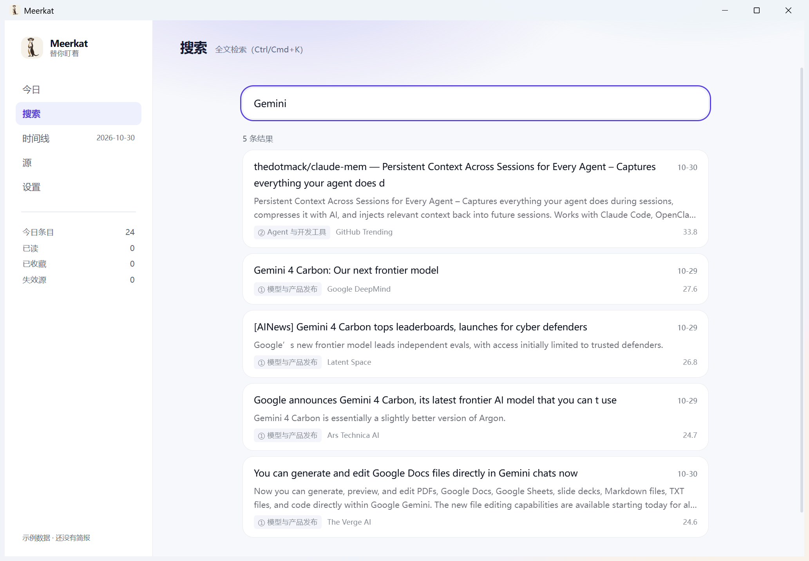

后端早就有了（SQLite FTS5 + `trigram` 分词，中文子串也能命中），缺的只是入口。
现在侧栏有「搜索」，`Ctrl/Cmd+K` 直接跳转。

上图是**真机截图**：搜 `Gemini` 出 5 条真实结果，带板块、来源、分数与摘要。

实现细节：
- 防抖 250ms——中文输入法组字期间不该每敲一下就查一次
- 点击开原文（走系统浏览器）
- 支持深链 `--route=search/Gemini`，也是以后 `meerkat://` 协议的基础

### 筛选、高亮、排序

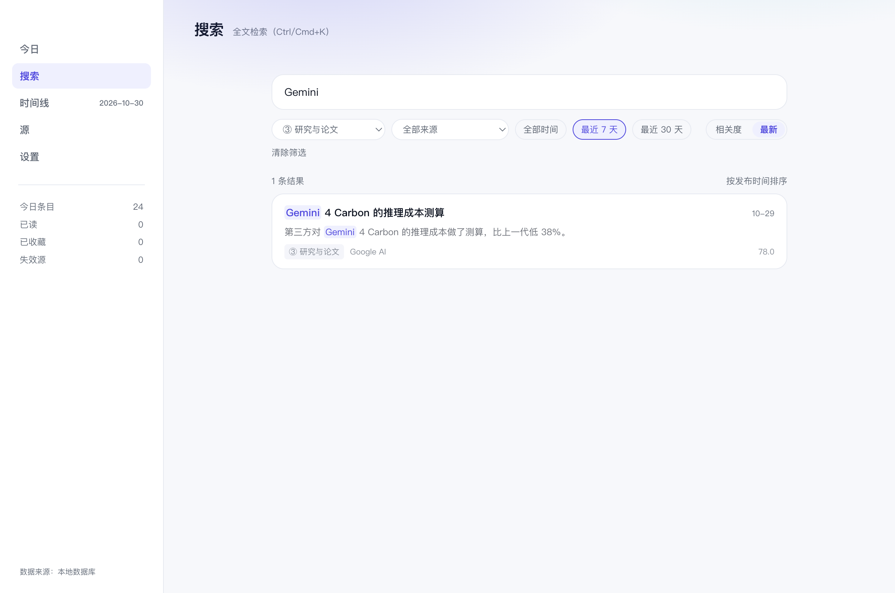

三个筛选（板块 / 来源 / 时间窗）+ 两种排序（相关度 / 最新），命中词在标题和摘要里高亮。

**筛选条件必须下推到 SQL，不能取回来再过滤**：查询上限是 50 条，先截断再筛会得到
"库里明明有、界面却说没有"的假空结果。`ItemStore.search` 因此接受
`{bucket, sourceId, sinceTs, sort}`，两条查询路径（FTS 与 <3 字符的 LIKE 兜底）共用同一套
条件拼接。时间筛选用 `COALESCE(published_at, fetched_at)`——没有发布时间的条目按抓取时间算，
否则它们会被窗口整批吞掉。

搜不到且开着筛选时，结果行会直接给一个「放宽筛选试试」，而不是让人对着空列表猜是哪一项卡住了。

---

## P2-10 编辑已有源


原来只能启用/停用/删除，改个名字都得删了重建。现在点源名称即可编辑：名称、地址、
层级、板块。

两条硬约束（`src/app/source-edit.ts`，11 个测试）：

- **id 与 kind 不可改**——id 是外键（`items.source_id` 指向它），kind 决定用哪个抓取器。
  改这两样等于换了个源，应该删了重建。
- **YouTube 源**填地址会重新解析 `channelId`；留空则保留原值。编辑时会把这个 id
  还原成可读的频道地址，用户不会面对一个空输入框。

---

## P3 反馈渠道

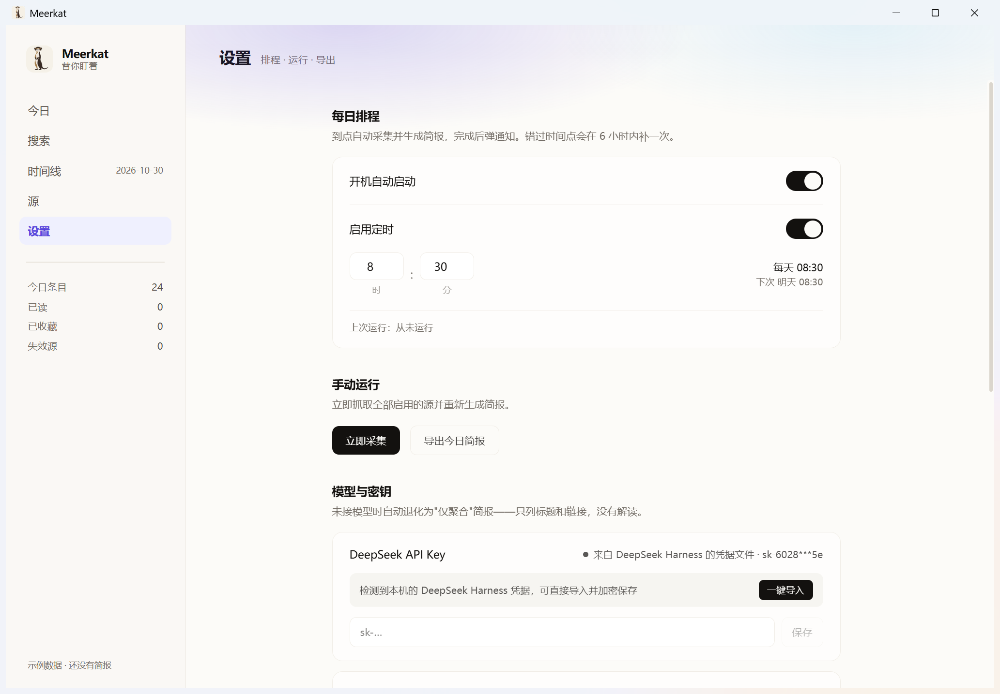

设置页 →「反馈」：选分类、写一句、点「生成反馈材料」。

**没有「提交」按钮，因为没服务器。** 一个点了没反应的提交按钮比没有更糟——
用户以为自己报过了，其实发进了虚空。

所以做的是"生成一份可以直接贴出去的材料"：

- 复制到剪贴板 / 保存为 `.md` / 打开预填 issue（配置了仓库才会出现）
- 材料 = 你的描述 + 版本平台 + **已脱敏**的诊断摘要（源健康度、最近运行、日志尾部 30 行）

### 安全边界

脱敏复用了 `diagnostic.ts` 的那套（19 个测试守着）：密钥、邮箱、路径里的用户名全部打码。
13 个反馈测试里有一条专门验证"用户自己粘进描述的密钥，过一遍脱敏也必须消失"。

### 快速修复流程

写在 `docs/FEEDBACK.md`：S1（起不来/丢数据/泄露）24 小时响应、72 小时内给修复或绕行；
S2 72 小时响应；S3 记录排期。

里面还有一条硬要求：**修 bug 必须先在 tests 里补一个能复现的测试**。
没有测试的修复会原样复发——这个项目已经踩过两次（定时链路没日志、托盘导出是死按钮）。

---

## P4 和昨天比

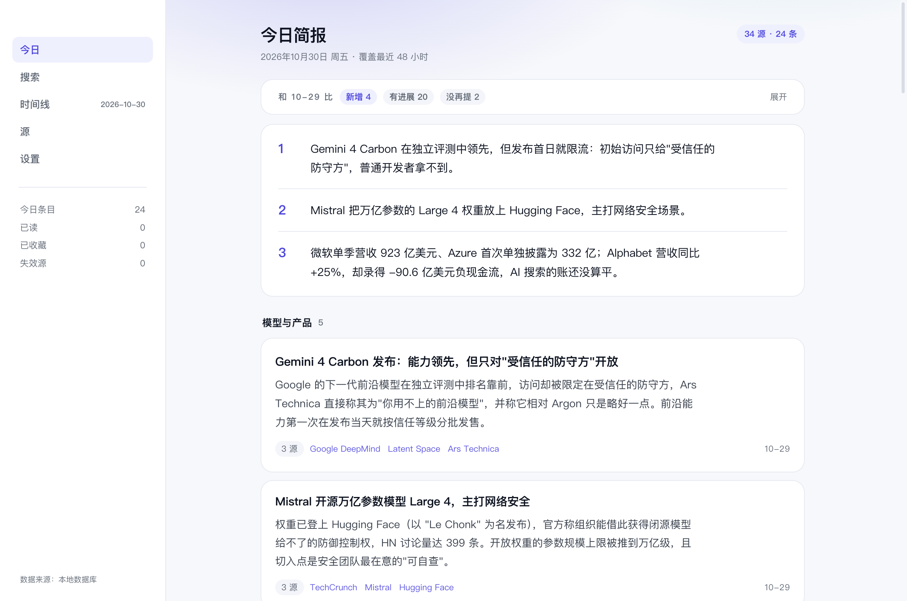

TODO 里挂了很久的一条：「今天有什么」已经有了，「和昨天相比变了什么」没有。
后者才是当初想做这个产品的原因——不是再来一份列表，而是知道**哪几条是新的**。

**做法是集合运算，不是让模型写一段对比。** 模型每次都能写出很像样的"今日变化"，
但没人能验证它说的是不是真的；集合运算的结论可以复算、可以断言。

`brief:latest` 的响应里直接带上上一期（不放单独 handler：两次 IPC 之间库里
可能刚好写了新简报，两期就对不上了），界面把两期 markdown 各解析一遍后交给
`src/core/pipeline/compare.ts`，得到三类：

| 分类 | 含义 |
|---|---|
| 新增 | 今天出现、上一期没有 |
| 有进展 | 上一期提过、今天还在讲（跨天去重会滤掉完全相同的条目，能留下的通常是同一事件的新文章） |
| 没再提 | 上一期提过、今天没有 |

**判定口径刻意与跨天去重一致**（URL 规范化后相同，或标题指纹相似度 > 0.86），
不另立阈值——否则会出现"同一件事采集时算重复、对比时算新增"的自相矛盾。
代价是标题差异极大的同事件会记成新增：宁可漏报，也不让"有进展"变成噪声。

界面默认收起，只露三个数字（多数时候你只想知道今天有没有新东西）；展开后
每条都能点，跳回正文对应位置。上一期的标题与今天不同时会并排显示，
方便判断是不是同一件事换了说法。

**验收**：`tests/compare-briefs.test.ts` 9 个用例（链接相同/标题相似/两边都空/
一条不被认领两次/多候选取最像的/URL 优先于标题）；界面在真窗口里截图确认过。

---

## 手动触发与取消

采集不必等到点：

| 入口 | 范围 | 行为 |
|---|---|---|
| 设置页「立即采集」 | 当前主题 | 抓取 + 成稿 + 落库，与定时任务同一条 `runDaily` |
| 设置页「重新成稿」 | 当前主题 | **不联网**，用最近 48 小时的素材重写一版 |
| 托盘「立即采集」 | 全部启用主题 | 依次跑，不依赖窗口是否打开 |
| `pnpm prep-schedule 2` | 当前主题 | 把排程拨到 2 分钟后，用于验收"到点自动触发" |

**重新成稿**解决的是这个场景：换了提示词、或者想要个不同说法，但不想再等 2 分钟抓取。
素材池＝该主题的源在 48 小时内抓到的条目，**排除今天之前已经推过的**（那是跨天去重该干的事），
但**保留今天已经推过的**——用户想重写的就是那一版。落库仍走覆盖保护：降级版不会盖掉完整版。

**取消**可以在运行中随时点（设置页的「取消」，或托盘里的「取消当前运行」）。
实现上是一根 `AbortController` 从 UI 穿到 IPC、穿到 `runCollect` 的每个 fetch、再穿到成稿请求：

- 取消不是失败：中途 abort 的源**不会**被记进源健康度，否则点一次取消就会让几个正在飞的源"凭空失败"
- 被取消的一轮不收数据：`runCollect` 在写库前检查 signal，避免半份数据污染"已推送"判定
- run 记录仍会收尾（`errors: ["cancelled"]`），不留 `finished_at` 为空的"假崩溃"

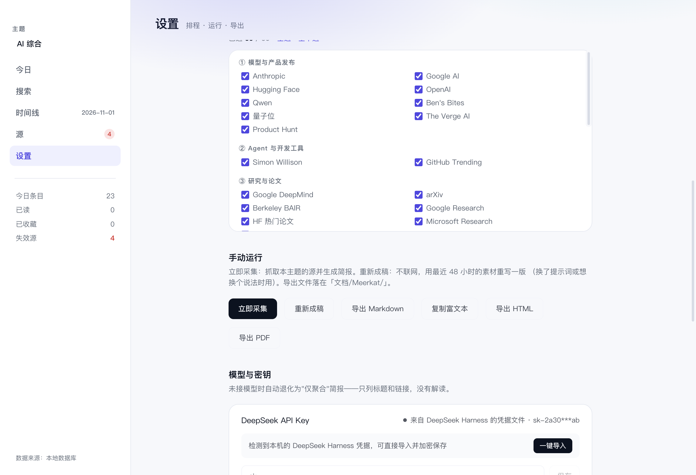

## 多主题


一个主题 ＝ **一组源 + 一套排程 + 一条独立简报**。侧栏切主题，今日、时间线、设置都跟着切。

- **数据**：`topics` / `topic_sources` / `brief_items` 三张表（schema v2）。老库升级时全部归到
  「AI 综合」并保留原简报，不会因为升级丢历史
- **「已推送」按 (主题, 条目) 记**：A 主题推过的内容，B 主题仍然该看到——这是最容易写错的一处，
  做成全局标记会让第二个主题永远缺一块
- **排程在主题行上**：调度器逐主题判定，托盘菜单列出每个主题的下次时间；「立即采集」不指定主题就跑全部启用主题
- **源集合按主题勾选**（设置页）：源本身仍是全局的，健康度、失败计数共享；只有"进不进这个主题"是各算各的

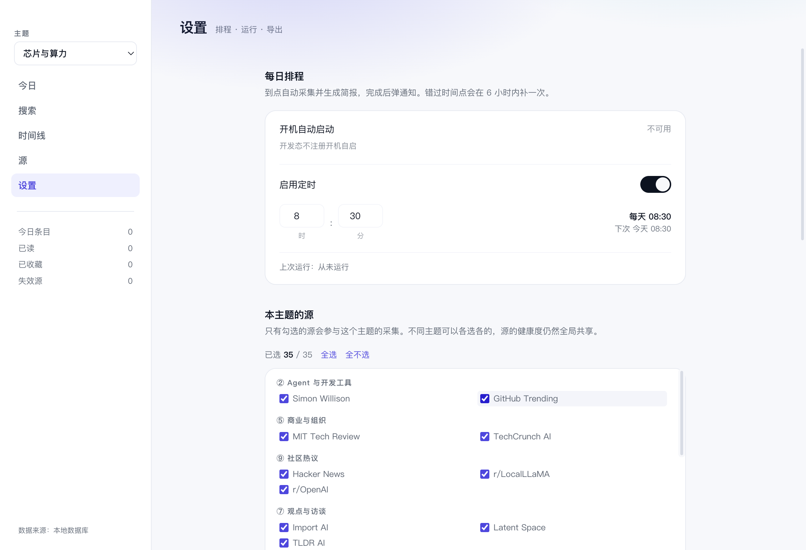

### 领域导航（侧栏切换器）

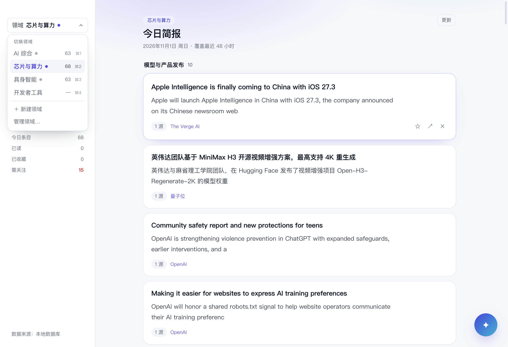

侧栏左上角是一行**领域切换器**：常驻显示当前领域与未读点，点开才是列表——
每行带最新一期条数、`⌘n` 提示，底部是「＋ 新建领域」（就地输入、回车创建）与「管理领域…」。

作用域和导航是两层：`⌘1–9` 直接切，切换后「今日」「时间线」跟着换，搜索仍是全库。
内容区标题上方显示领域 chip，作为当前作用域的标签（不响应点击，避免两个切换入口）。

位置与形态的依据见 [docs/DOMAIN-PLACEMENT.md](docs/DOMAIN-PLACEMENT.md)。

### 领域 → 主题（两层）

领域是分组，主题才是采集与简报的单位：侧栏顶部切领域，下面列当前领域的主题。

加源时可以直接勾选归属主题（按领域分组、默认当前主题），并给一个规则推荐
「✨ 建议：… · 采用」——推荐只是默认值，点不点由你决定。源列表每行显示它属于哪些主题，
一个都没有的会标红「未加入任何主题 · 不会被采集」。

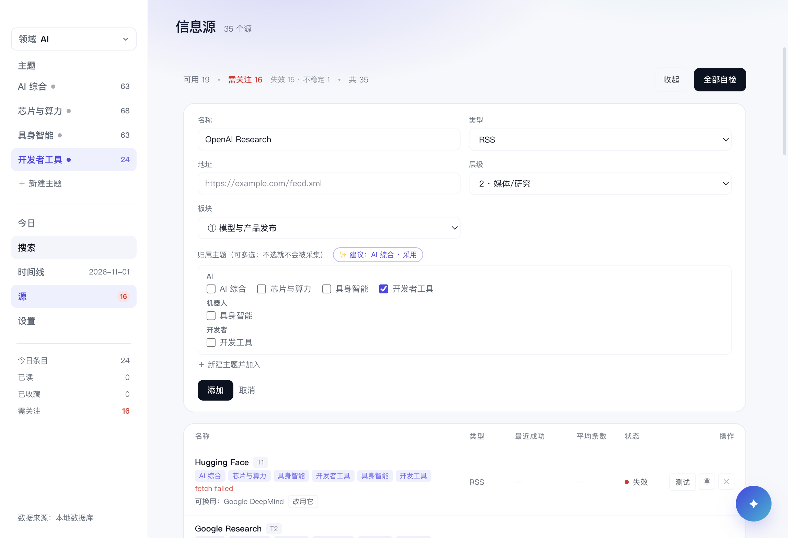

领域级汇总（每天把所有主题的简报合成一份「领域综述」）在 P2，设计见
[docs/DOMAIN-ROLLUP.md](docs/DOMAIN-ROLLUP.md)。
没有简报的领域显示「「X」还没有简报」+「立即采集」，而不是一个空的 0 条。

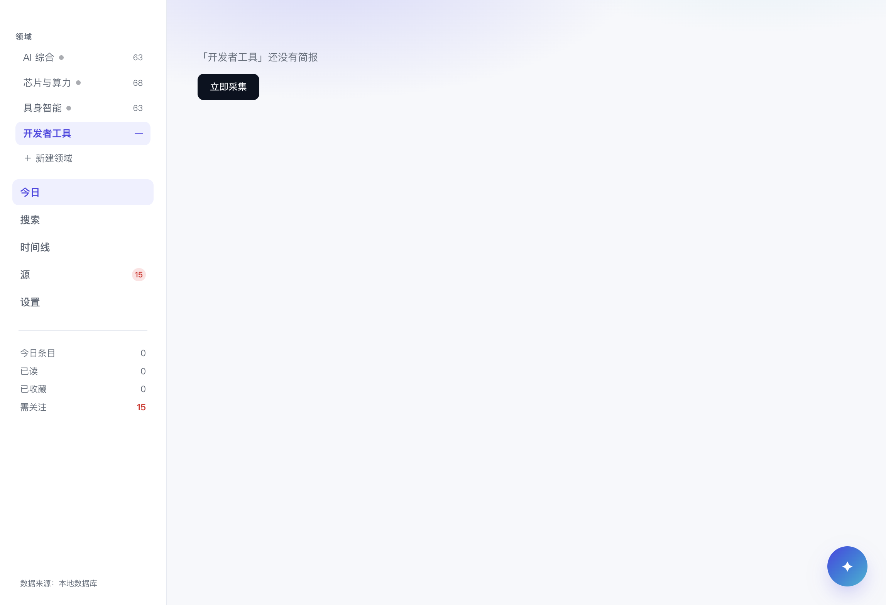

**引导页的「选领域」现在真的会建主题**：选几个领域就建几个主题，每个主题默认收录全部源，
之后在设置页各自裁剪。

日常增减主题走设置页的「主题」区块：改名、删除、新建。删除会带走这个主题的简报与源归属，
源本身（以及它的健康度）不受影响；至少要留一个主题，删到最后一个会被拦下。

## AI 对话（P0）

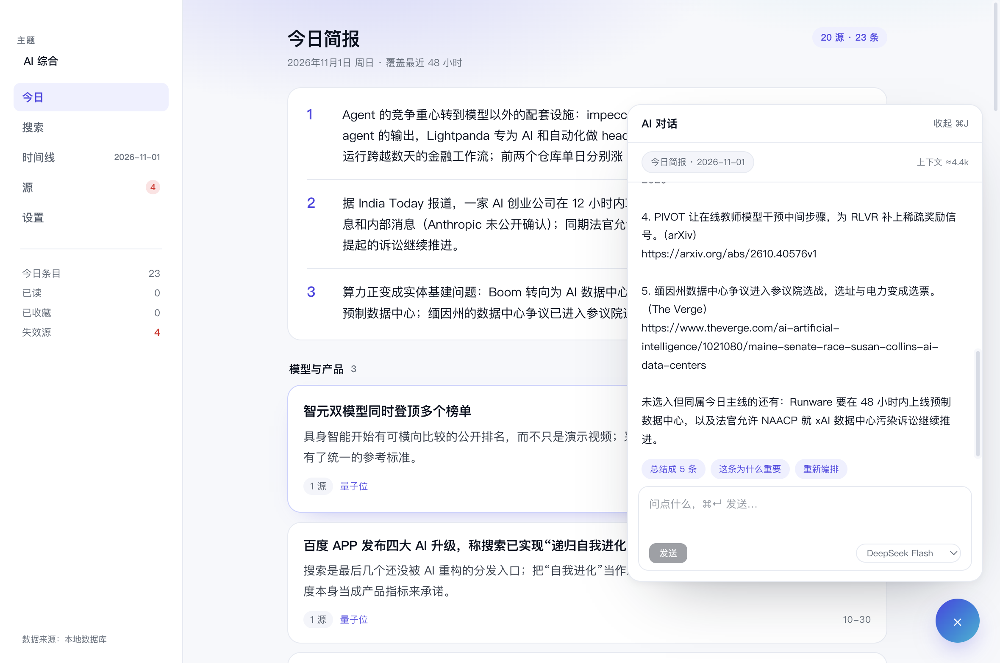

右下角一个按钮（`⌘J` / `Ctrl+J` 开合），打开一份**带上下文的对话**：上下文就是今天这期简报，
可选把上一期也带上。回答只依据简报内容——简报里没有的，它会说「没提到」，而不是拿外部知识补全。

- **动作开箱即用**：总结成 5 条 / 和昨天比 / 这条为什么重要（「重新编排」与草稿态一起留到 P2）
- **多供应商**：DeepSeek / OpenAI / Anthropic 各配一把 key，模型下拉只列已配置的；按会话记忆，每条回答标注用了哪个
- **上下文有预算**：24k tokens 上限，超出按"简报优先、上一期最可牺牲"的比例裁剪，面板上显示「上下文 ≈4.4k」
- **能停**：正在回复时点「停止」，错误框显示「已取消」，不会把半截回答当结果

**多供应商与协议差异**：DeepSeek 与 OpenAI 走 OpenAI 兼容协议，Anthropic 走 Messages 协议
（`x-api-key`、`system` 顶层、`content[]` 响应）。key 按供应商分别加密保存，也可以走环境变量；
**成稿也优先走同一套供应商**（DeepSeek → OpenAI → Anthropic），模型 id 可在设置里覆盖（模型下线时不用改代码）。

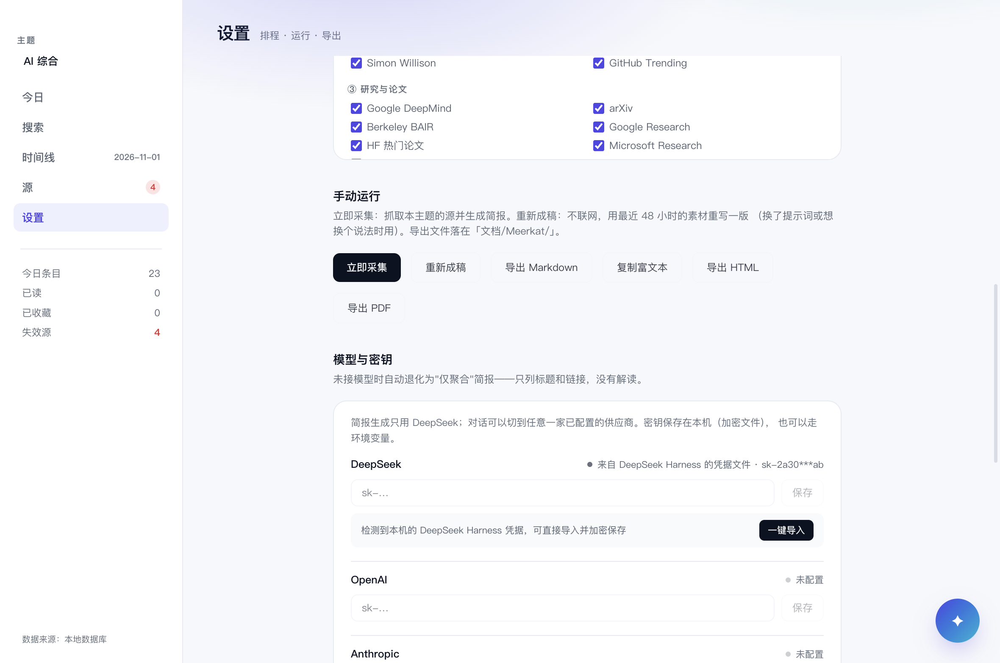

**模型接入方式**：目前只有 API Key（DeepSeek / OpenAI / Anthropic 各配一把，或走环境变量）。
本机已安装的 Agent（Codex / Claude Code / Ollama）已调研，但延迟与授权成本不划算，暂不接入——
调研数据与方案见 [docs/HARNESS.md](docs/HARNESS.md)。

**P0 的边界**：非流式、每个主题每天一段会话、重排尚未开放（与草稿态一起在 P2）。
设计稿与后续阶段见 [docs/AI-CHAT.md](docs/AI-CHAT.md)。

## 已知环境限制（已大幅缩小）

早期这个项目有一大段"无法真机验证"的说明，大部分**已被推翻**——原因是我执行环境的
三个污染源，不是产品问题：

| 当时以为 | 实际 |
|---|---|
| 本机跑不了 Electron | 只有 **Electron 45** 跑不了，**38 正常** |
| 通知不可用 | 可用（`isSupported=true`） |
| 托盘图标没进通知区 | 进了（`bounds=1416,1094,33x49`） |
| 打包版必须带 `--no-sandbox` | 不需要 |

**现在只剩两条注意事项**（写给在这个仓库里继续开发的人）：

1. `ELECTRON_RUN_AS_NODE=1` 可能被注入到你的 shell。启动 Electron 前先
   `Remove-Item Env:\ELECTRON_RUN_AS_NODE`，否则你跑起来的其实是纯 Node。
2. 应用**放在本工作区目录内**可能无法启动（文件沙箱会干扰 Chromium 子进程）。
   验收时把它复制到 `%TEMP%` 再运行。

**日常启动用安装位，不要用 `release\win-unpacked`**：直接跑那里的 exe 会**静默秒退**
（无窗口、无日志、事件日志无崩溃记录），和工作区那条是同一个根因。装到用户目录后一切正常：

```powershell
robocopy release\win-unpacked "$env:LOCALAPPDATA\Programs\Meerkat" /E
& "$env:LOCALAPPDATA\Programs\Meerkat\Meerkat.exe"
```

用户数据在 `%APPDATA%\Meerkat`（数据库、日志、加密密钥），与 exe 位置无关，
所以重装/换位置不会丢数据。开机自启注册的是实际运行的那个路径。

**渲染层自测**：`pnpm build` 后用 `scripts/serve-static.cjs` 起静态服务，
再用 Chrome headless 截图 `out/renderer/`，可快速验证 UI。

**磁盘**：安装依赖后一度只剩 2.2GB（系统临时文件占用），现已恢复到 126GB，不再是约束。

---

## 目录

```
src/
├── core/        纯 TS 无依赖：domain / ports / pipeline / policy
├── adapters/    http / sources / store-sqlite / llm / render
├── app/         用例：collect / compose-brief / manage-sources
├── main/        Electron 主进程
├── preload/     contextBridge 窄接口
└── renderer/    React 19 + Tailwind 4
scripts/
├── run-electron.cjs   跑 Electron 脚本的唯一正确方式
├── verify-sqlite.cjs  P1-0 原生模块验证
└── serve-static.cjs   渲染层截图用的静态服务器
```

---

## 常量来源

打分与分析参数全部沿用 Python 原型 `../ai-radar/`（已跑通 35 个源），
移植时以它为基准，并用同一份 `items-*.json` 做 golden test（分数差 <0.1）。

| 项 | 值 |
|---|---|
| 层级权重 | tier1 26 / tier2 18 / tier3 10 |
| 时效衰减 | `14 × exp(-ageHours/20)` |
| 互动量 | `min(12, 3.2 × log10(1+points))` |
| 去重阈值 | 标题相似度 > 0.86 |
| 回看窗口 | 全局 48h / arXiv 96h / HN 48h |
| 单次上限 | 80 条 |
| LLM | deepseek-flash，temp 0.55，max_tokens 16000 |
