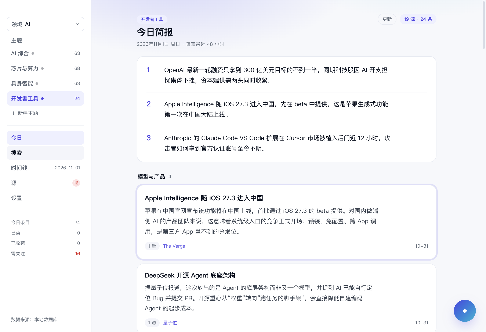
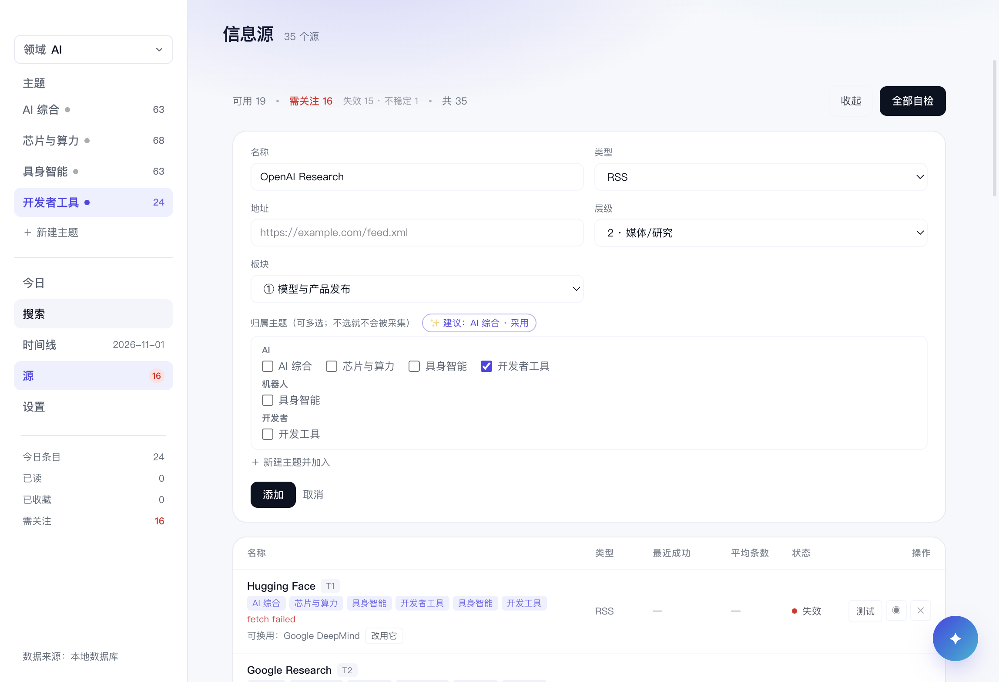
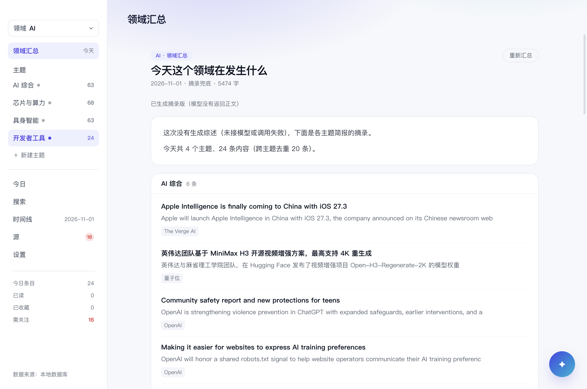

# Meerkat

[English](README.md) · **简体中文**

**让你轻松看清任何领域的变化。**

一个本地优先的每日简报工具：你在意哪个领域，它就只留真正变了的事，并告诉你和昨天比什么变了。



> v0.1.1 · 400 个测试 · typecheck / build 通过 · macOS 实测，Windows 由 CI 出包

## 下载

到 [Releases](https://github.com/husleng24/meerkat/releases) 下载安装包：

| 平台 | 文件 |
|---|---|
| macOS（Apple Silicon） | [Meerkat-0.1.1-arm64.dmg](https://github.com/husleng24/meerkat/releases/download/v0.1.1/Meerkat-0.1.1-arm64.dmg) |
| macOS（Intel） | [Meerkat-0.1.1-x64.dmg](https://github.com/husleng24/meerkat/releases/download/v0.1.1/Meerkat-0.1.1-x64.dmg) |
| Windows（安装版） | [Meerkat-0.1.1-x64.exe](https://github.com/husleng24/meerkat/releases/download/v0.1.1/Meerkat-0.1.1-x64.exe) |
| Windows（便携版） | [Meerkat-0.1.1-portable.exe](https://github.com/husleng24/meerkat/releases/download/v0.1.1/Meerkat-0.1.1-portable.exe) |

两个平台都没有代码签名：macOS 首次打开需右键「打开」（或
`xattr -dr com.apple.quarantine /Applications/Meerkat.app`）；Windows SmartScreen 选
「更多信息 → 仍要运行」。

## 它是什么

- **本地优先的桌面简报工具**：数据、密钥、简报都在你自己机器上，没有服务端
- 面向每天只有 5 分钟、想知道"这个领域今天真正变了什么"的人
- 按「领域 → 主题」组织：一个领域是一组主题，一个主题有自己的源、排程和简报

## 它不是什么

- 不是资讯聚合器：目标是**少而准**，一期 15–24 条，宁少勿滥
- 不是在线服务：没有账号、没有云同步
- 不是通用阅读器：只保留标题、一句解读和原文链接，不做全文抓取
- 不是聊天机器人：内置对话只用来问和总结今天的简报

## 功能

### 每天一份简报

48 小时窗口内抓取、打分（层级 26/18/10 + 时效衰减 + 互动量）、去重，再由模型写成
"三句话速览 + 分板块条目 + 今日一句"。没有配置模型时自动降级为"仅聚合"版，不会空白。

### 领域 → 主题

侧栏顶部切领域，下面是该领域的主题；`⌘1–9` 直接切。主题是采集与简报的单位，
领域是分组与汇总的单位。**新建主题默认只带 8 个按语料推荐的源**，不再和别的主题全量重复。



### 和昨天比

报头下方给出 `新增 / 有进展 / 没再提` 三个数，点开可看具体是哪几条。

### 搜索、时间线与阅读状态

FTS5 全文检索（支持板块、源、时间筛选、高亮、排序）；时间线按日期回看历史简报；
已读/收藏/隐藏都落库，简报里的条目按 URL 反查回条目 id。

### 源管理

源是全局的（健康度按源算），归属按主题多对多。源页显示连续失败与不稳定，给出替代源建议；
新增源时按领域分组勾选归属主题，并给一个可解释的规则推荐。设置里可以按主题搜索、勾选、
或用「✨ 按主题推荐」补源。

### 领域汇总

每天 08:45（各主题跑完后）把同一领域各主题当天的简报合成一份：一段跨主题综述 +
分主题条目，跨主题按 URL 去重。没接模型或调用失败时出摘录兜底稿，不阻塞。
侧栏「领域汇总」页可随时手动重新汇总。



### AI 对话

右下角浮层（`⌘J`）：基于当天简报提问、总结，可切换已配置的供应商。每个主题每天一段会话，
上下文只带简报与历史消息，不重发原始素材。重排（把简报重新编排）留到 P2。

### 升级提醒

启动时查一次 GitHub 最新 Release（24 小时内不重复），有新版本时**侧栏底部**出现一条
「↓ 新版本 v0.1.2 · 下载」，点一下打开 Release 页（changelog 与安装包都在那里）。
设置 →「关于」可以手动检查，并就地展开这次更新了什么。只提示、不自动下载——两个平台都未签名。

### 导出

Markdown / HTML / PDF / 复制富文本，落在 `文档/Meerkat/`。

## 快速开始

### 环境

- Node 20+、pnpm 11
- macOS 或 Windows；原生模块首次安装时编译（better-sqlite3）

```bash
pnpm install
pnpm dev          # 开发（electron-vite）
```

打包：

```bash
pnpm build        # 只构建 out/
pnpm dist         # Windows NSIS 安装包（配置见 electron-builder.yml）
# macOS 本机验证可用：pnpm exec electron-builder --mac --dir
```

### 首次启动

引导页选几个领域 → 自动建领域/主题并挂上默认源 → 立即采集一次（约 1–2 分钟）。
之后每天按排程自动跑；也可以在报头点「更新」手动触发。

### 三个容易踩的环境坑

1. **`ELECTRON_RUN_AS_NODE=1`** 会让 Electron 退化成纯 Node（报 `bad option: --no-sandbox`）。
   启动前清掉：`env -u ELECTRON_RUN_AS_NODE ...`
2. **better-sqlite3 必须按 Electron 的 ABI 重编**：`pnpm rebuild:native`（即
   `electron-builder install-app-deps`），否则启动即崩。
3. **国内网络**：Electron 二进制下不动时设 `ELECTRON_MIRROR=https://npmmirror.com/mirrors/electron/`；
   node-gyp 头文件设 `npm_config_disturl=https://npmmirror.com/mirrors/node/`。

完整复现步骤见 [docs/HISTORY.md](docs/HISTORY.md)。

## 使用

### 领域、主题、源

- 设置 →「领域」管理分组；「主题」按领域分组，每行有「选源」直达该主题的源列表
- 主题的源可以搜索、勾选，或用推荐；全部选中时会提示"会和别的主题重复"
- 源页「新增源」需要选类型/地址/层级/板块，并勾选要加入的主题

### 排程与手动运行

每个主题默认 08:30，领域汇总默认 08:45；错过会在 **6 小时内**补跑一次。设置页可改时间、
关掉定时、立即采集或取消。托盘菜单显示下次运行时间，跑完弹通知。

### 模型与密钥

- 供应商：DeepSeek、OpenAI、Anthropic（前两家走 OpenAI 兼容协议，Anthropic 走 Messages）
- 密钥按供应商分别加密保存在 `userData`（`secret.bin` / `secret-<provider>.bin`），
  也可以走环境变量 `DEEPSEEK_API_KEY` / `OPENAI_API_KEY` / `ANTHROPIC_API_KEY`
- 支持从本机 DeepSeek Harness 的凭据文件一键导入
- 成稿优先 DeepSeek → OpenAI → Anthropic；设置里可以覆盖某家的模型 id（模型下线不用改代码）

### 数据在哪

| 内容 | 位置 |
|---|---|
| 数据库 | `app.getPath('userData')/meerkat.db`（macOS `~/Library/Application Support/Meerkat`；Windows `%APPDATA%\Meerkat`） |
| 密钥 | 同目录下的加密文件 |
| 日志 | 同目录 `logs/main.log` |
| 导出 | `文档/Meerkat/` |

## 架构

```
renderer (React)  ──IPC──▶  main（Electron 组装）
                                │
                    app（用例：采集/成稿/对话/汇总）
                                │ 只依赖端口
                    core（domain / pipeline / policy / ports，纯逻辑）
                                ▲
              adapters（sqlite / sources / llm）实现端口
```

| 层 | 目录 | 职责 |
|---|---|---|
| core | `src/core` | 领域模型、打分与去重、提示词上下文、端口接口；不 import 任何适配器 |
| app | `src/app` | 用例：采集、成稿、推荐、汇总、诊断；只依赖 core 的端口 |
| adapters | `src/adapters` | SQLite 仓储、各类源抓取、OpenAI/Anthropic 协议、Composer |
| main | `src/main` | Electron 组装、IPC、排程、托盘、导出、密钥 |
| renderer | `src/renderer` | React 界面，只通过 `window.meerkat` 访问主进程 |

**数据模型（schema v5）**：`sources` / `topics` / `topic_sources` / `domains` / `items` /
`briefs` / `brief_items` / `domain_briefs` / `item_flags` / `chat_threads` / `chat_messages` /
`runs` / `settings`，迁移按 `PRAGMA user_version` 递增，只增不改。

**IPC 约定**：入参一律在边界用 zod 校验；长任务走事件推送进度；handler 返回 Result 形状，
不把异常抛给渲染层。仓储接口全部同步（better-sqlite3 本身同步）。

## 质量

| 项 | 现状 |
|---|---|
| 测试 | `pnpm test`：**389 通过**（单元 + jsdom + 本地 HTTP stub） |
| 类型 | `pnpm typecheck`：node 与 web 两套 tsconfig 都过 |
| 构建 | `pnpm build` 通过；`pnpm dist` 产出 Windows 安装包 |
| 真机验收 | 每条功能都截图核对过，记录见 [docs/VERIFICATION-RESULT.md](docs/VERIFICATION-RESULT.md) |

常用命令：`pnpm dev` / `pnpm test` / `pnpm typecheck` / `pnpm build` / `pnpm dist` /
`pnpm run-once`（采集一次）/ `pnpm compose-once`（成稿一次）/ `pnpm prep-schedule`（造排程数据）。

## 已知限制

- **Windows 安装包**：`electron-builder.yml` 已就绪，但 NSIS 安装包尚未在 Windows 本机验证
- **开发态菜单栏显示 Electron**：macOS 的应用名来自 `.app` 的 `Info.plist`，运行时改不了；
  打包后的 `Meerkat.app` 正常（Dock 图标已在开发态用 `app.dock.setIcon` 修正）
- **单实例**：多开只会唤起已有窗口，不支持并排
- **AI 对话非流式**：一次返回；重排功能在 P2
- **升级只提醒、不自动下载**：点「下载更新」跳到 Release 页面
- **领域汇总的质量依赖各主题简报**：主题当天没出简报时用它最新一期，没有的话跳过

## 文档

| 文件 | 内容 |
|---|---|
| [PRODUCT.md](PRODUCT.md) | 用户、定位、产品约束 |
| [ARCHITECTURE.md](ARCHITECTURE.md) | 分层与接缝的完整说明 |
| [DESIGN.md](DESIGN.md) | 功能设计与数据流 |
| [docs/VISUAL-WORLD.md](docs/VISUAL-WORLD.md) | 视觉规范：色值、字号、版式规则 |
| [docs/AI-CHAT.md](docs/AI-CHAT.md) | AI 对话的设计与实现状态 |
| [docs/DOMAIN-ROLLUP.md](docs/DOMAIN-ROLLUP.md) | 领域汇总的设计与实现 |
| [docs/DOMAIN-TOPIC-MODEL.md](docs/DOMAIN-TOPIC-MODEL.md) | 领域/主题两层模型的评估 |
| [docs/TOPIC-NAV.md](docs/TOPIC-NAV.md) / [docs/DOMAIN-PLACEMENT.md](docs/DOMAIN-PLACEMENT.md) | 领域导航的调研与取舍 |
| [docs/HARNESS.md](docs/HARNESS.md) | 本机 Agent harness 的调研（暂缓） |
| [docs/TODO.md](docs/TODO.md) | 待办、已知限制与工程债 |
| [docs/FEEDBACK.md](docs/FEEDBACK.md) | 反馈分级与修复流程 |
| [docs/VERIFICATION-RESULT.md](docs/VERIFICATION-RESULT.md) | 真机验收原始记录 |
| [docs/RELEASE.md](docs/RELEASE.md) | 发版流程与产物说明 |
| [docs/HISTORY.md](docs/HISTORY.md) | P1–P4 开发日志与实现细节（归档） |

## 开发约定

- **提交信息用英文**（标题命令式，正文解释为什么），代码注释、文档、界面文案用中文
  （由 `.githooks/commit-msg` 强制，启用：`git config core.hooksPath .githooks`）
- 提交前必须跑 `pnpm test` 与 `pnpm typecheck`；改了 UI 要截图核对，不只信类型
- 架构红线：`core` 不 import 适配器；`app` 只依赖 core 端口；`main` 负责组装
- 同一份逻辑只有一份实现（桌面「立即采集」与脚本共用同一个 `runCollect`）

## 许可证

[MIT](LICENSE) © 2026 husleng24
