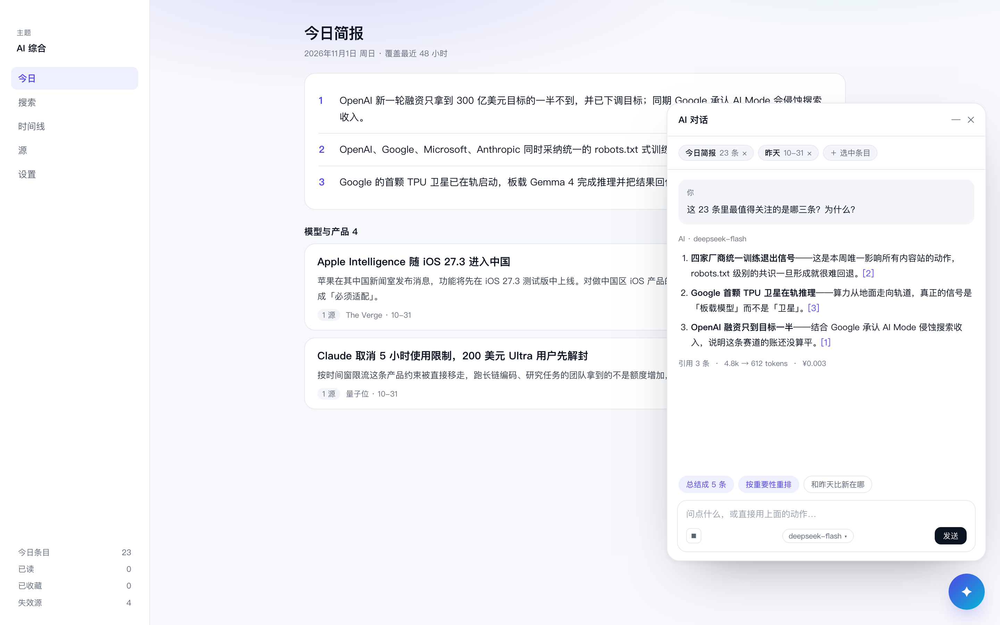

# AI 对话入口（右下角浮层）设计方案

> 状态：**P0 已实现**（2026-11-01）。P1/P2 未做，见文末「实施状态」。
> 目标读者是接下来写这段代码的人（很可能是未来的我）。
> 关联：`docs/TODO.md`、`ARCHITECTURE.md`、`DESIGN.md`

---

## 一、调研：别人怎么做的

### 1.1 Multica（主参照）

[Multica](https://multica.ai/about) 是「人 + AI 智能体一起工作」的协作产品，它的聊天设计与本需求最接近：

- **右下角圆形按钮**，悬停提示「问 Multica」，点开是**悬浮聊天窗**；工作区任何页面都能打开
- 浮窗里的对话和侧边栏「聊天」页**是同一份**：在哪边开始，另一边都能接着聊
- `⌘J`（Windows/Linux 是 `Ctrl+J`）打开/收起，打开后光标直接落在输入框；在输入框里也能用这个键收起
- 浮窗**可拖边改大小**、可展开、可最小化；智能体回复时，收起后的按钮会**轻轻跳动**
- 聊天页本身不显示这个按钮（整页已经是同一段对话），也可以在设置里**按设备**关掉浮窗
- 输入框支持 `@` 引用上下文（教程里是「@ 当前任务，对话会带上这条任务的上下文」）、`+` 挂项目上下文
- 首条消息前给**最多 3 个建议**（点了只填进输入框、不发送）；回复后给**后续提问**，点击直接发送
- 回复中还能继续输入：发送键变「排队发送」，可**引导**（停当前回复、跳到队首）、删除、编辑、清空
- 可**停止**执行；如果还没输出任何内容就停，刚发的那条消息**连同附件退回输入框**

> 出处：[与智能体对话](https://multica.ai/docs/zh/chat)、[完整教程](https://multica.ai/docs/zh/tutorial)

### 1.2 Readwise Reader · Ghostreader

阅读器里的 AI 助手，最值得借鉴的是「上下文粒度」与「预设动作」：

- 对着**整篇文档**或**选中的一小段**提问，提示词库随选择大小变化（选 1–3 个词走词典/百科）
- 预设 prompt 是主要入口，`G` 对选中内容、`Shift+G` 对全文，聊天在**右侧栏**，回复后可以继续追问
- 另有跨全库的 Global Ghostreader，回答**带引用链接**

> 出处：[What is Ghostreader?](https://docs.readwise.io/reader/guides/ghostreader/overview)

### 1.3 ChatGPT Windows 桌面版 · Companion Window

- `Alt+Space` 随时唤起一个**独立的 companion 窗**，记住上次位置，重置回屏幕下方居中
- 与主窗口的会话历史打通（关了还能从历史里接着聊）

> 出处：[Using the ChatGPT Windows app](https://help.openai.com/en/articles/9982051-using-the-chatgpt-windows-app)

### 1.4 提炼出的六条结论

| # | 结论 | 对 Meerkat 的含义 |
|---|---|---|
| 1 | 入口要「随手可得、但不打断阅读」 | 右下角 FAB + `⌘J`，浮层不占正文左侧 |
| 2 | 会话是**全局**的，不属于某一条简报 | 会话按主题/日期记上下文，但线程本身独立 |
| 3 | 上下文必须**显式可见、可移除** | 输入框上方用引用胶囊，不允许"偷偷塞进去" |
| 4 | **默认动作**比空白输入框有用 | 首启给 3 个随上下文变化的动作 |
| 5 | 生成物要能**落地**，否则只是聊天玩具 | 重排结果可预览、可导出、可一键还原 |
| 6 | 运行中必须**能打断** | 复用已有的 `AbortController` 取消链路 |

---

## 二、目标与非目标

### 目标（v1）

1. 对**当前简报**提问、要细节、要解释
2. **总结 / 汇总**：把 23 条压成 5 条、按板块汇总、生成一段可转发的文字
3. **重新编排**：按重要性/板块/时间重排，输出一版新稿（**草稿态**，不直接覆盖原简报）
4. **和昨天比**：把上一期作为额外上下文，问"新在哪"
5. **选模型**：至少 DeepSeek flash / pro 可切；每条回复标注用了哪个模型
6. 不打断阅读：浮层可收起、可拖动、可最小化

### 非目标（v1 明确不做）

- **不做 Agent 工具调用**（不联网搜索、不写文件、不改数据库原始条目）
- **不自动改简报**：重排只产出草稿，应用与否由人决定
- 不做多设备/云端会话同步（本产品没有服务器）
- 不做团队共享会话
- 不做图片/文件上传（简报本身没有富媒体）

---

## 三、形态与交互

### 3.1 入口

- 右下角 **48px 圆形按钮**，距边 20px；所有页面都有（除了将来可能的"对话整页"）
- 悬停显示「问一问」；有新回复且面板收起时，按钮叠一个小红点
- 点击打开右侧浮层；再次点击或 `Esc` 收起
- `⌘J` / `Ctrl+J` 全局切换；打开后焦点落在输入框
- **回复中**按钮做 2s 呼吸动画（Multica 的做法），但**不做声音/系统通知**

### 3.2 浮层



> 上图是按现有视觉规范做的静态稿：右下角按钮、浮层、上下文胶囊、快速动作、模型选择都在里面。
> 数字与引用是示意，不是真实回答。

线框（用于对齐布局细节）：

```
┌──────────────────────────────────────────────┬───────────────────────┐
│  今日简报                                     │  AI 对话        —  ✕  │
│  2026-11-01 周日 · 覆盖最近 48 小时            ├───────────────────────┤
│                                              │ 上下文                │
│  ┌────────────────────────────────────────┐  │ [今日简报 ×] [昨天 ×] │
│  │ 1  OpenAI 融资只拿到目标一半…            │  ├───────────────────────┤
│  └────────────────────────────────────────┘  │ 你：这 23 条里最值得   │
│  ┌────────────────────────────────────────┐  │ 关注的是哪三条？为什么 │
│  │ 2  四家厂商统一训练退出信号…             │  │                       │
│  └────────────────────────────────────────┘  │ AI：① 训练退出信号…    │
│  ┌────────────────────────────────────────┐  │ ② TPU 卫星…            │
│  │ 3  Google 首颗 TPU 卫星在轨…            │  │ ③ 融资下调…            │
│  └────────────────────────────────────────┘  │        [引用 3 条 ↗]   │
│                                              │                       │
│                                              ├───────────────────────┤
│                                              │ [总结5条][重排][比昨天]│
│                                              │ ┌───────────────────┐ │
│                                              │ │ 问点什么…    ⌘↵  │ │
│                                              │ └───────────────────┘ │
│                                              │ deepseek-flash ▾  ⏹  │
└──────────────────────────────────────────────┴───────────────────────┘
```

尺寸与行为：

| 项 | 值 |
|---|---|
| 默认宽度 | 420px（正文区 ≥ 820px 时） |
| 可拖拽范围 | 360–720px；拖左边缘改变宽度 |
| 全屏化 | 双击标题栏 / 按钮，占满右侧 60% |
| 最小化 | 收回到 FAB，保留会话 |
| 记忆 | 宽度与展开状态存 `localStorage` |
| 小窗 | 窗口宽度 < 900px 时自动全屏化浮层（没有并排空间） |

### 3.3 键盘

| 键 | 行为 |
|---|---|
| `⌘J` / `Ctrl+J` | 打开/收起浮层，焦点进输入框 |
| `Esc` | 收起浮层（回复不中断） |
| `⌘↵` | 发送 |
| `↑` | 编辑上一条（输入框为空时） |
| `⌘.` | 停止当前回复 |

> 与现有键盘模型的关系：`j/k/s/o/m/h` 只在浮层**收起**时生效——浮层打开时焦点在输入框，正文快捷键让位（这也是 BriefView 已有的「输入框聚焦不抢键」规则）。

---

## 四、上下文：Context Pack

### 4.1 三种来源

| 来源 | 何时带上 | 形式 |
|---|---|---|
| **当前简报** | 默认 | 完整 markdown（受预算裁剪） |
| **选中条目** | 点卡片上的「问一问」，或在输入框 `@` | 该条目的 title/body/链接 |
| **上一期简报** | 点「和昨天比」，或手动 `@昨天` | 完整 markdown（受预算裁剪） |

主题与日期始终作为元信息带上（`主题：AI 综合 · 日期：2026-11-01`）。

### 4.2 预算

- 单次请求上下文硬上限 **24k tokens**（按字符数 × 0.6 粗估，宁可保守）
- 超出时**按段落裁剪**：先砍上一期，再砍当前简报的"板块正文"，保留标题行与速览
- 裁剪后在引用胶囊上显示「已裁剪 40%」，并在回复脚注说明——不能悄悄截断

### 4.3 实现形态

纯函数，便于测试：

```ts
// src/core/chat/context.ts
export interface ContextSource {
  kind: 'brief' | 'previous' | 'item'
  label: string
  text: string
}

export function buildContextPack(
  sources: ContextSource[],
  budgetTokens: number
): { text: string; dropped: Array<{ label: string; ratio: number }> }
```

---

## 五、动作模型（Quick Actions）

预设动作就是「固定 prompt + 当前上下文」，不是隐藏的魔法：

| 动作 | Prompt 要点 | 输出 |
|---|---|---|
| **提问** | 用户自己写 | 段落 + 引用 |
| **总结成 5 条** | 只保留事实，每条 ≤ 60 字，带来源链接 | 列表 |
| **按重要性重排** | 重排 + 保留原文事实，不新增 | **草稿 markdown** |
| **和昨天比** | 输入两期，输出新增/延续/消失 | 列表 |
| **这条为什么重要** | 针对单条，解释影响面 | 段落 |
| **扩写成一段可转发的文字** | 300 字以内，口语 | 段落 |

首启时面板里显示前 3 个（随上下文变化：没有上一期就不显示「和昨天比」）。

---

## 六、重新编排：草稿态，不覆盖

这是整个功能里**唯一会写数据**的路径，必须把「AI 的产物」和「今天的简报」分开：

1. 动作「按重要性重排」→ 模型返回完整 markdown
2. 界面进入**草稿预览**：左"当前"、右"重排后"，逐段 diff
3. 三个出口：**应用到视图** / **导出草稿** / **丢弃**
4. 应用后：顶部出现「正在查看 AI 草稿 · 恢复原版」；**数据库里的原简报不动**
5. 草稿另存 `brief_drafts` 表，同一 (主题, 日期) 只保留最近一版

为什么不做"直接替换"：`briefs` 是"今天推过什么"的事实记录，也是跨天去重的依据（`brief_items` 与成稿引用绑定）。让模型改写它，会让"已推送"的语义跟着漂移，而且不可恢复。

---

## 七、模型选择

### 7.1 端口

现有 `Composer` 是"一次成稿"，对话需要的是多轮 + 流式，所以新增端口：

```ts
// src/core/ports/chat.ts
export interface ChatModelInfo {
  id: string              // 'deepseek-flash'
  label: string           // 'DeepSeek Flash'
  provider: string        // 'deepseek'
  contextWindow: number
  /** 相对成本档位，用于界面提示 */
  tier: 'fast' | 'deep'
}

export interface ChatMessage {
  role: 'system' | 'user' | 'assistant'
  content: string
}

export interface ChatDelta { text?: string; done?: boolean }

export interface ChatProvider {
  readonly id: string
  listModels(): Promise<ChatModelInfo[]>
  stream(
    input: { model: string; messages: ChatMessage[]; maxTokens: number; temperature: number },
    onDelta: (d: ChatDelta) => void,
    signal: AbortSignal
  ): Promise<{ ok: true; usage: { input: number; output: number } } | { ok: false; reason: string; detail: string }>
}
```

### 7.2 内置与选择

- v1 内置 **DeepSeek**：`deepseek-flash`（默认，快/便宜）、`deepseek-v4-pro`（重排和长文用它）
- **按会话**选模型，输入框右下角小胶囊切换；切换只影响后续消息
- 每条 assistant 消息记录 `model`，气泡下方标注
- **auto 默认**：普通问答 flash；「重排」「汇总 20 条以上」自动切 pro（预估输出 > 2k tokens）
- 未来加 OpenAI / Anthropic：只需实现 `ChatProvider` 并注册；key 仍走现有 keystore，按 provider 存

### 7.3 成本可见

- 输入框上方常驻一行灰字：`上下文 6.2k · 预计输出 ≤2k · 约 ¥0.004`
- 一次会话累计显示在标题栏 tooltip
- 超过单次 ¥0.05 时先弹确认（防手滑把整期简报 + 昨天 + 20 条选中一起发）

---

## 八、数据模型（迁移 v3）

```sql
CREATE TABLE chat_threads (
  id         TEXT PRIMARY KEY,
  title      TEXT NOT NULL,          -- 第一条消息前 12 字，可改
  topic_id   TEXT NOT NULL,
  brief_date TEXT,                   -- 创建时的简报日期，仅作上下文默认值
  model      TEXT NOT NULL,
  created_at INTEGER NOT NULL,
  updated_at INTEGER NOT NULL,
  archived   INTEGER NOT NULL DEFAULT 0
);

CREATE TABLE chat_messages (
  id         TEXT PRIMARY KEY,
  thread_id  TEXT NOT NULL,
  role       TEXT NOT NULL,          -- user | assistant
  content    TEXT NOT NULL,
  model      TEXT,                   -- assistant 才有
  tokens_in  INTEGER,
  tokens_out INTEGER,
  context_json TEXT,                 -- 引用了哪些来源（brief/date/itemId），不存副本
  created_at INTEGER NOT NULL,
  FOREIGN KEY (thread_id) REFERENCES chat_threads(id) ON DELETE CASCADE
);

CREATE TABLE brief_drafts (
  id         TEXT PRIMARY KEY,
  topic_id   TEXT NOT NULL,
  date       TEXT NOT NULL,
  markdown   TEXT NOT NULL,
  model      TEXT NOT NULL,
  action     TEXT NOT NULL,          -- 产出它的动作 id
  created_at INTEGER NOT NULL
);
CREATE UNIQUE INDEX idx_draft_slot ON brief_drafts(topic_id, date);
```

**只存引用，不存简报副本**：`context_json` 记 `{ brief: '2026-11-01', previous: '2026-10-31', items: ['id1'] }`，渲染时再取。否则库里会存下十几份同样的 8k 字 markdown。

---

## 九、接口与流式

```ts
// preload
chat: {
  threads(): Promise<ThreadSummary[]>
  create(input: { topicId: string; date: string }): Promise<{ id: string }>
  send(input: { threadId: string; text: string; model: string; context: ContextRef }): Promise<{ ok: boolean; error?: string }>
  cancel(threadId: string): Promise<{ cancelled: boolean }>
  onDelta(cb: (e: { threadId: string; text: string }) => void): () => void
  onDone(cb: (e: { threadId: string; messageId: string; usage: { in: number; out: number } }) => void): () => void
}
models: { list(): Promise<ChatModelInfo[]> }
drafts: { apply(id: string): Promise<...>; discard(id: string): Promise<...> }
```

- 流式通过 `webContents.send('chat:delta', …)` 推送，不走 `invoke` 的返回值
- **取消**复用 `AbortController` 的既有语义（`src/main/run-control.ts` 的模式），但**用独立控制器**：聊天不能把正在跑的采集取消掉，反之亦然
- 主进程 `src/main/chat.ts` 负责编排：取上下文 → 组 messages → 流式转发 → 落库

---

## 十、安全、隐私、成本

| 项 | 决定 |
|---|---|
| 密钥 | 复用 keystore；按 provider 一个条目；聊天不显示明文 |
| 日志 | **不记录消息正文**，只记 threadId、模型、token 数、耗时（正文可能含用户隐私） |
| 诊断包 | 不含聊天内容 |
| 网络 | 只有模型 API；v1 不做工具调用，不发任何第三方请求 |
| 上下文 | 只在发送时拼接；本地库里只存引用 |
| 删除 | 删会话即级联删消息；`brief_drafts` 随主题删除级联 |

---

## 十一、分阶段

| 阶段 | 内容 | 预估 |
|---|---|---|
| **P0** | FAB + 浮层 + 上下文=当前简报 + 3 个动作 + DeepSeek flash + 非流式 + 取消 | 1 天 |
| **P1** | 流式 + 会话持久化 + 选中条目 + flash/pro 切换 + 成本提示 | 1.5 天 |
| **P2** | 「和昨天比」+ 重排草稿（diff/应用/导出）+ 快捷键完善 | 1.5 天 |
| **P3** | 第二个 provider（OpenAI 或 Anthropic）+ 自定义 prompt 库 | 2 天 |

P0 就能验证"这东西有没有用"：如果 P0 上线后自己不用，P1/P2 不必做。

---

## 十二、验收标准

- 点开浮层 **≤ 200ms** 出现骨架，不白屏
- 流式首字 **≤ 1.5s**（DeepSeek flash，正常网络）
- 点停止 **≤ 1s** 生效，已输出内容保留
- 上下文超预算时**主动裁剪**并在界面标注，不是静默截断
- 「重排」**不修改** `briefs` 表；应用草稿后「恢复原版」一键还原
- 每条回复标注模型；切换模型不影响历史消息
- 删除会话后，消息一并消失（外键级联，测试覆盖）
- 单元测试：`buildContextPack` 的裁剪顺序、动作 prompt 模板、草稿状态机
- 真机：`⌘J` 打开后焦点在输入框；`Esc` 收起；回复中按钮有呼吸动画

---

## 十三、风险

| 风险 | 应对 |
|---|---|
| 模型编造链接 | 回复要求逐字引用；渲染前用现有 `validateLinks` 校验，坏链标红 |
| 浮层挡住正文 | 可拖拽/最小化；宽度 < 900px 时默认全屏化而不是并排 |
| 成本失控 | 预算上限 + 单次费用确认 + 默认 flash |
| DeepSeek 429 | 退避 + 明确提示"稍后再试"，不复用采集的失败计数 |
| 会话越聊越长 | 只带最近 6 轮进上下文，更早的折叠成"摘要一行"（P2 再做） |
| 与采集抢资源 | 独立 AbortController；同一时刻允许一边采集一边聊天（都是 IO 等待） |

---

## 十四、和现有架构怎么接

| 层 | 新增 | 说明 |
|---|---|---|
| `core/ports/chat.ts` | `ChatProvider` / `ChatModelInfo` / `ChatMessage` | 与 `Composer` 并列，不合并——一个是"一次成稿"，一个是"多轮流式" |
| `core/chat/context.ts` | `buildContextPack` | 纯函数，先写测试 |
| `core/chat/actions.ts` | 动作定义与 prompt 模板 | 纯数据 + 模板函数 |
| `adapters/llm/deepseek-chat.ts` | DeepSeek 流式实现 | 复用 `baseUrl`/model 常量；SSE 解析 |
| `main/chat.ts` | 编排、落库、事件推送 | 唯一持有 AbortController 的地方 |
| `renderer/src/components/ChatFab.tsx` | FAB + 浮层外壳 | 只在 App 挂一次 |
| `renderer/src/components/ChatPanel.tsx` | 消息流、引用胶囊、模型切换 | |
| `renderer/src/components/ChatDraft.tsx` | 重排草稿的 diff 预览 | P2 |

---

## 十五、一句话总结

**右下角一个按钮，打开一份"带上下文的对话"；上下文显式可摘，动作开箱即用，模型可换，输出可落地——但绝不背着用户改简报。**

---

## 十六、实施状态（2026-11-01）

### 已做（P0）

- 右下角 FAB + 浮层，`⌘J` / `Ctrl+J` 开合，`Esc` 收起，尺寸与开关状态记在 localStorage
- 上下文＝当前简报（可选带上「昨天」），24k tokens 预算，超出按比例裁剪并在胶囊上显示「上下文 ≈nan」
- 三个动作：总结成 5 条 / 和昨天比（无上一期时自动隐藏）/ 这条为什么重要
- 多供应商：DeepSeek / OpenAI / Anthropic 各自一把 key（加密文件或环境变量），模型下拉只列已配置的
- 按会话记忆模型；每条回答标注用了哪个
- 回答按 markdown 渲染（粗体 / 列表 / 链接），不再露出 `**` 与 `[文字](url)` 原文
- 简报在对话之后被重写过时，面板顶部提示「历史回答可能对不上当前内容」，可一键重新开始
- 窄窗口（<900px）时面板占满宽度，不压正文
- 停止：复用 AbortController 语义，取消后错误框显示「已取消」
- 会话持久化：`chat_threads` / `chat_messages`（迁移 v3），每主题每天一段
- 测试：上下文预算 10 个、动作模板 4 个、对话仓储 5 个、IPC 边界 3 个

### 与设计稿的偏差（有意为之）

| 设计稿 | 实际 | 原因 |
|---|---|---|
| 流式输出（P1） | 非流式 + 「正在读简报…」 | 先把"问了有没有用"验证掉，流式留到 P1 |
| 只有一个供应商（P0） | 已支持三家（P0.5） | 决定：P0 就要能吃多套 key、处理协议差异 |
| 多会话列表 | 每主题每天一段 | P0 不需要会话管理；按天一段也符合"读完今天这期顺手问" |
| 选中条目作为上下文 | 未做 | 需要卡片上的入口与 `@` 选择器，P1 |
| 「重新编排」在 P0 | **从界面移除**，提示词保留在 `actionPrompt('reorder')` | 决定：重排与草稿态一起在 P2 上线，先不做"没地方落地的 markdown" |
| 上下文里带「条目清单」 | 只带简报 markdown | 简报本身已含标题与链接，先不做冗余 |

### 多供应商与协议差异（P0.5）

- **成稿也走同一套供应商**：`dailyDeps` 只挑一个"成稿目标"（DeepSeek → OpenAI → Anthropic），
  用 `createChatComposer` 把对话供应商包装成 `Composer`——只配了 OpenAI 的机器不再被迫降级
- **模型 id 可覆盖**：设置页每个供应商有一个「模型 id」输入框，写到 `chat.model.<provider>`；
  覆盖时**替换**该供应商的默认模型（不追加，避免留下选了就 404 的旧模型）
- 目录在 `core/chat/providers.ts`：三个供应商、两种协议（OpenAI 兼容 / Anthropic Messages）
- 协议差异收敛在适配器里：Anthropic 用 `x-api-key` + `anthropic-version`、`system` 提到顶层、
  响应是 `content[]` 数组、`max_tokens` 必填；相邻同角色消息会被合并（Anthropic 要求交替）
- key 按供应商分文件（`secret.bin` 是 DeepSeek 的历史位置，其余 `secret-<id>.bin`），
  环境变量按 `DEEPSEEK_API_KEY` / `OPENAI_API_KEY` / `ANTHROPIC_API_KEY` 读
- 模型下拉只列**已配置 key** 的供应商——避免"选了也发不出去"
- 测试：本地 HTTP 假服务器做协议级断言（7 个），keystore 隔离 6 个

### 已知问题

- 首条消息的标题取前 16 字，可能把动作提示词当标题（如「把今天这期简报总结成 5 条」）——可接受，P2 做会话列表时再改
- 面板宽度固定 420，窗口变窄时会压住正文；P1 做响应式（<900px 自动全屏化）
