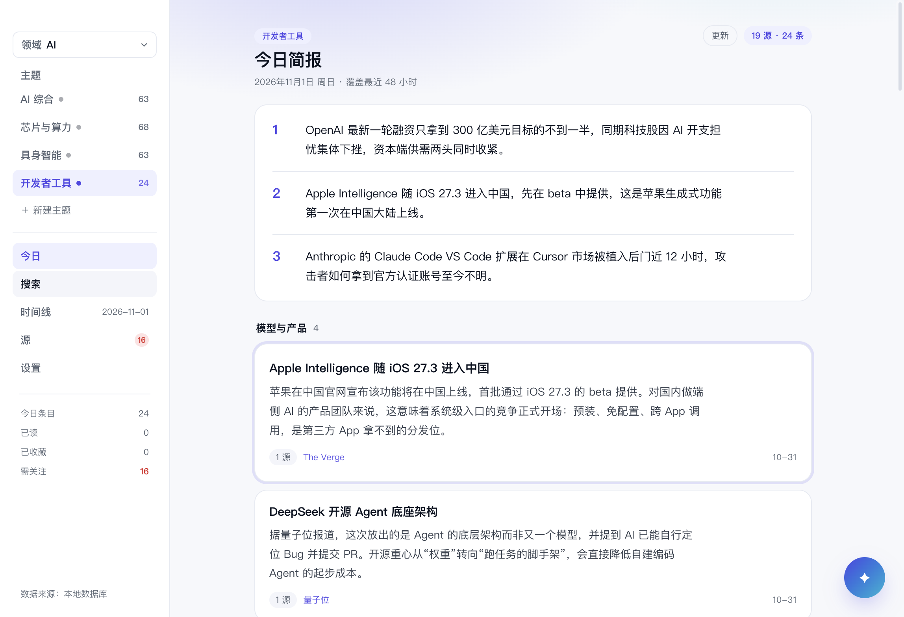
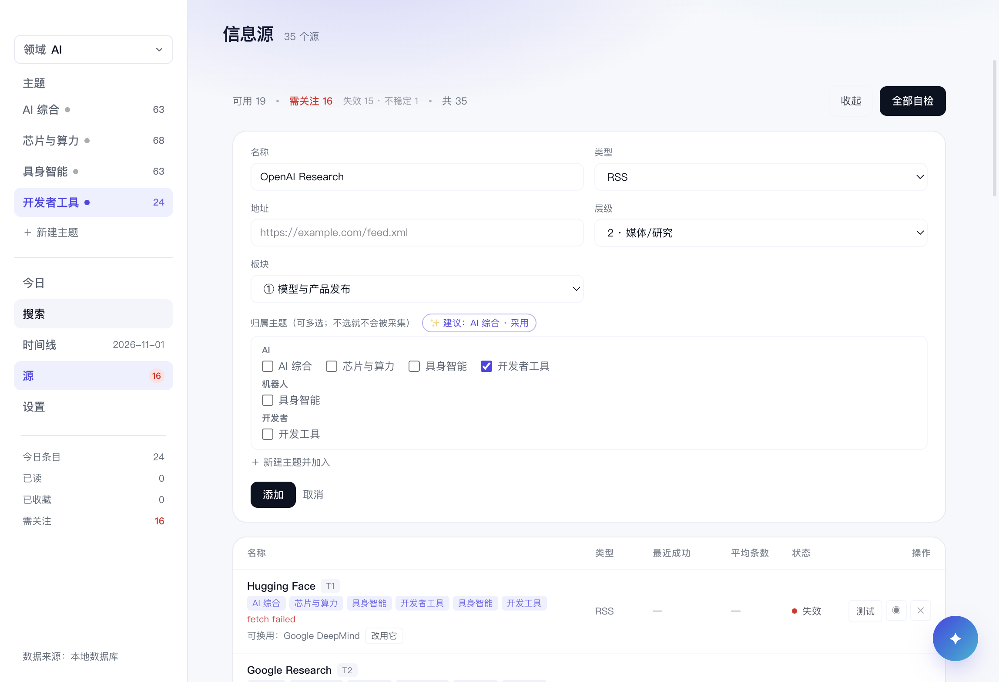
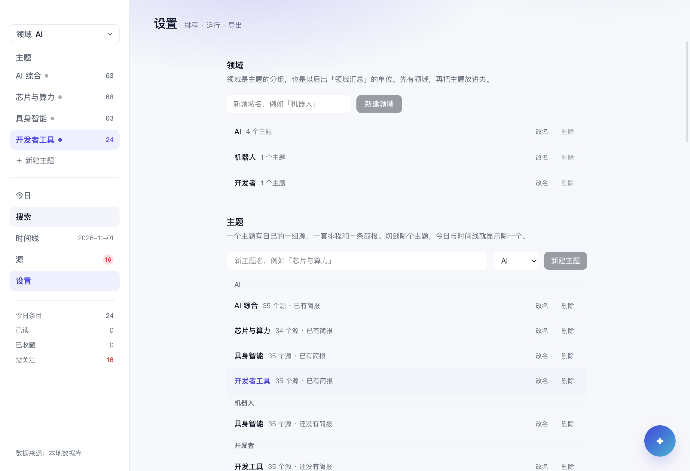
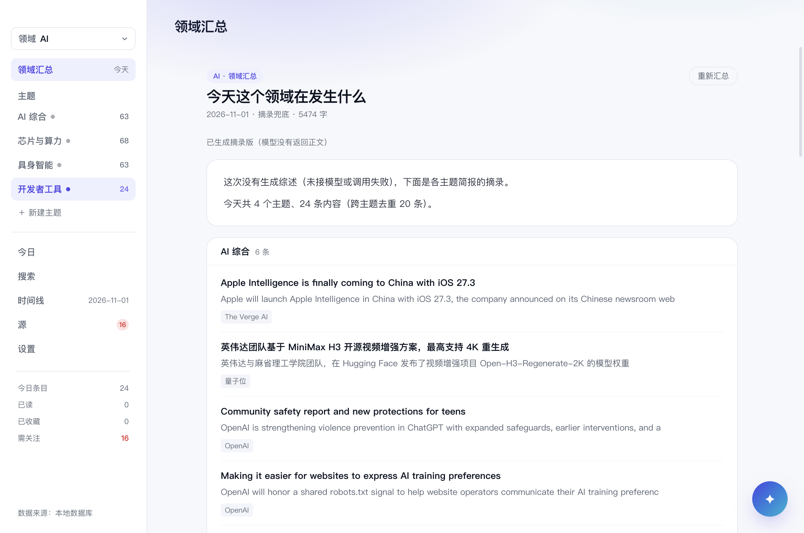

# 领域汇总 + 加源归属：设计

> 方向：源在添加时选主题（可让内置 Agent 推荐），主题归入领域，领域出跨主题的汇总简报。
> 状态：**已移除**（2026-11-12）。领域汇总的 UI、IPC、08:45 自动任务与 `domain_briefs` 表都已删除；
> 本文只保留为设计记录。
> 2026-11-01。上一版评估见 [DOMAIN-TOPIC-MODEL.md](DOMAIN-TOPIC-MODEL.md)。

---

## 一、为什么这次成立

上一版评估的结论是"领域若只是文件夹，不值得建表"。这次补上的两件事正好改变了前提：

1. **加源时选主题 + Agent 推荐** → 领域/主题有了明确的归属入口，不再是隐性配置
2. **领域级汇总** → 最上面那层真的产出一份东西，而不只是容器

所以按 **C（汇总层）** 做，但拆成三步，先让归属闭环，再让汇总上线。

---

## 二、目标模型

```
领域 AI
├─ 主题：模型与产品      源：OpenAI / Anthropic / The Verge…
├─ 主题：芯片与算力      源：NVIDIA / SemiAnalysis…
└─ 主题：Agent 与工具    源：GitHub Trending / HN…

领域 机器人
├─ 主题：具身智能        源：…
└─ 主题：人形机器人      源：…

每天：
  08:30  各主题各自采集 + 出主题简报（现状不变）
  08:45  领域汇总：把该领域各主题的简报合成一份「领域综述」
```

- **源**仍然全局（健康度、失败计数按源算），归属写成"源 → 主题"的多对多
- **主题**是采集与简报的单位（沿用现有 `briefs.topic_id`）
- **领域**是汇总与排程的单位（新增 `domain_briefs`）

---

## 三、数据模型（schema v4）

```sql
CREATE TABLE domains (
  id         TEXT PRIMARY KEY,
  name       TEXT NOT NULL,
  enabled    INTEGER NOT NULL DEFAULT 1,
  created_at INTEGER NOT NULL
);

ALTER TABLE topics ADD COLUMN domain_id TEXT NOT NULL DEFAULT 'ai';
-- 迁移：所有旧主题归入默认领域「AI」，保证老数据不丢

CREATE TABLE domain_briefs (
  id         TEXT PRIMARY KEY,        -- `${date}-${domainId}`
  domain_id  TEXT NOT NULL,
  date       TEXT NOT NULL,
  markdown   TEXT NOT NULL,
  model      TEXT NOT NULL,
  tokens_in  INTEGER NOT NULL DEFAULT 0,
  tokens_out INTEGER NOT NULL DEFAULT 0,
  created_at INTEGER NOT NULL
);
```

`topic_sources` 不变；`briefs` 不变。

---

## 四、加源时的归属

### 4.1 表单

```
名称  [ OpenAI News        ]
类型  [ RSS ▾ ]   地址 [ https://openai.com/news/rss.xml ]
层级  [ 2 ▾ ]     板块 [ ① 模型与产品 ▾ ]
领域  [ AI ▾ ]    主题 [ ☑ 模型与产品  ☐ 芯片与算力  ＋ 新建主题 ]
                  ┌────────────────────────────────────┐
                  │ ✨ 推荐：模型与产品（理由：域名与   │
                  │    现有 3 个模型类源一致）  [采用] │
                  └────────────────────────────────────┘
```

- 默认勾选**当前主题**，领域默认当前领域
- 「＋ 新建主题」就地输入，归到当前领域
- 保存时同时写 `topic_sources`

### 4.2 推荐的实现：先规则，后 LLM

| 层 | 做法 | 成本 |
|---|---|---|
| 规则（默认，离线可用） | 源名/URL/最近标题与每个主题的语料（已有条目标题、源名）做关键词重合度打分；取最高分 | 0 |
| LLM（有 key 时可选） | 一次小调用：输入源元信息 + 候选主题列表，返回 `{topicId, confidence, reason}` 或 `{newTopic}` | 1 次短请求 |
| 兜底 | 都不确定时默认当前主题，并提示"没把握，已放进当前主题" | 0 |

**必须由用户确认**，不静默归类；推荐只作为表单里的一个「采用」按钮。

---

## 五、领域汇总怎么生成

### 5.1 触发

- 默认 **08:45**（各主题 08:30 跑完），或该领域所有启用主题的当日简报都齐了之后
- 也可以手动「重新汇总」（设置页 / 汇总页）

### 5.2 输入

不重读全部条目，只读各主题**已经生成好的简报**：

- 每个主题的「三句话速览」+ 该期前 N 条（含标题、链接、来源）
- 总计控制在 24k token 预算内（复用现有 context 预算逻辑）

### 5.3 输出结构

```markdown
# AI 领域 · 2026-11-01 汇总

## 今天这个领域在发生什么（3–5 句）
跨主题的共同趋势：…

## 模型与产品（5 条）
- …（链到该主题简报里的条目）

## 芯片与算力（4 条）
- …

## Agent 与工具（3 条）
- …
```

- 跨主题**去重**：同一 URL/同一事件只出现一次，归到最相关的主题
- 末尾注明"由 N 个主题的简报合成，原始条目见各主题"
- LLM 失败时降级：直接拼接各主题速览（无综述句），不阻塞

### 5.4 成本

每个领域每天 1 次调用；3 个领域 ≈ 3 次，和现在每个主题一次是同一量级。

---

## 六、界面

- **侧栏**：顶部仍是领域切换器；切换器里领域下缩进列出主题（可展开），另加一项「领域汇总」
- **领域汇总页**：报头显示「AI · 领域汇总 · 2026-11-01」，正文即 5.3 的结构；顶部可「重新汇总」
- **加源表单**：见 4.1
- **设置页**：领域管理（增删改）→ 每个领域下管理主题；源的归属仍在「本领域的源」里细化

---

## 七、排程

- 主题排程保持现状（每个主题一套时间）
- 领域汇总时间默认 08:45，可关闭；手动汇总始终可用
- 若某主题当天没跑成，汇总仍生成，并在开头注明"缺少 X 主题"

---

## 八、分阶段

| 阶段 | 内容 | 工期 |
|---|---|---|
| **P0 归属闭环** | `domains` 表 + `topics.domain_id` + 迁移；设置页两级管理；加源选主题（规则推荐）；源列表显示所属主题 | 1.5–2 天 |
| **P1 推荐增强** | LLM 推荐主题（有 key 时），带理由与置信度；可新建主题/领域 | 0.5 天 |
| **P2 领域汇总** | `domain_briefs` + 汇总生成 + 汇总页 + 08:45 排程 | 1.5–2 天 |

合计约 4–5 天。P0 单独上线就有价值（加源不再悬空），P2 才是"两层"的完整形态。

---

## 九、风险

| 风险 | 缓解 |
|---|---|
| 层级变深，读简报多一次点击 | 记住上次的领域+主题，启动直接进入；汇总页一屏看完，不需要逐个点 |
| 领域汇总质量差（重复、空话） | 输入只取各主题前 N 条 + 去重；失败降级为拼接；不阻塞主题简报 |
| 迁移丢失归属 | v4 迁移把旧主题全部挂到默认领域，并写一个迁移测试（旧库升级后主题数、源归属不变） |
| 文案重置 | 现在界面叫「领域」的其实是 topic：改叫「主题」，新层才叫「领域」；文档与 README 同步 |
| LLM 成本翻倍 | 汇总每天每领域 1 次；可关闭自动汇总，只保留手动 |

---

## 十、需要你定的

1. **一个源能不能同时进多个主题？**（现在多对多；若只允许一个，表单和推荐都会更简单）
2. **领域汇总要"综述 + 分主题条目"，还是只要一段综述？**（前者可读性强，后者更短）
3. **领域汇总默认自动（08:45）还是手动？**（自动省事，但多一次调用）

---

## 十一、P0 实施记录（2026-11-01）

已落地：

- **schema v4**：`domains` 表；`topics.domain_id`（默认 `ai`）；迁移把旧主题全部归入「AI」，
  有迁移测试覆盖（旧库升级后主题、源归属、简报都还在）
- **仓储与 IPC**：`domains:list/create/rename/remove`；领域下有主题时拒绝删除；
  `topics:create` 校验领域存在
- **设置页**：新增「领域」管理区（改名/删除/新建），「主题」区按领域分组，新建主题时选领域
- **侧栏**：领域切换器（点开切领域）+ 当前领域的主题列表；`＋ 新建主题` 就地创建
- **加源**：表单里按领域分组勾选主题（默认当前主题）；规则推荐会给一个候选
  （`app/suggest-topic.ts`，按源名/域名与主题语料的重合度，可解释、可拒绝）
- **源列表**：每行显示所属主题；一个都没有的标红「未加入任何主题 · 不会被采集」







与设计稿的差异：

- 推荐先用**规则版**（P1 的 LLM 版还没做）：离线可用、可解释、零调用成本
- 弹层宽度仍与切换器同宽；主题列表放在切换器下方常驻，而不是塞进弹层——切换主题比切领域频繁
- 源列表的主题 chip 暂时只显示主题名；跨领域同名时会看不出属于哪个领域（下一步加领域前缀）

## 十二、P2 实施记录（2026-11-01）

- **schema v5**：`domain_briefs`（按 `domain_id + date`），重新汇总会覆盖同一天的稿子
- **生成**（`src/main/domain-daily.ts`）：只读各主题**当天**的简报（某主题没跑成则用它最新一期），
  跨主题按 URL 去重，最多每主题 6 条；有模型时出「综述 + 分主题条目」，
  没模型或调用失败时出摘录兜底稿（明说"没有生成综述"），不阻塞、不写空稿
- **排程**：默认 08:45，在主题跑完之后执行；每个领域记自己的 `domain.lastRunAt`，
  某个领域失败不影响别的；手动「重新汇总」始终可用
- **界面**：侧栏领域切换器下方新增「领域汇总」入口；页面展示综述卡 + 分主题条目卡，
  链接可点；稿子由 `domain-brief:updated` 事件驱动刷新
- **测试**：解析/去重/兜底/提示词 6 个，生成链路 5 个（含模型失败回退），IPC 2 个



已实测：无 key 的 profile 下走兜底稿（4 个主题、24 条、去重 20 条）；模型路径由假 provider 单测覆盖。

补充（同日两次修复）：

1. 领域汇总原先只在「有主题到点」的 tick 里检查，主题都跑过的日子它永远不会自动跑。
   现在独立判断（`anyDomainDue`），但沿用主题排程的 **6 小时补跑窗口**——19:00 重启不会
   补跑 08:45 的汇总，这是有意的，避免停机一天后开机跑一堆。
2. 空领域（主题还没有简报）之前记 error 并误报「完成」，现在记 info「跳过」并写 lastRunAt，
   不再每分钟重试刷日志；手动汇总也会写 lastRunAt，避免重启后重复生成。

汇总属于**领域**，不属于某个主题。原来在汇总页点侧栏主题只会改 activeTopic、
页面内容不动，看起来像坏了；现在从汇总页选主题会直接回到该主题的「今日」简报，
汇总页的 meta 也写明「N 个主题 · M 条」，说明它是跨主题合成的。
