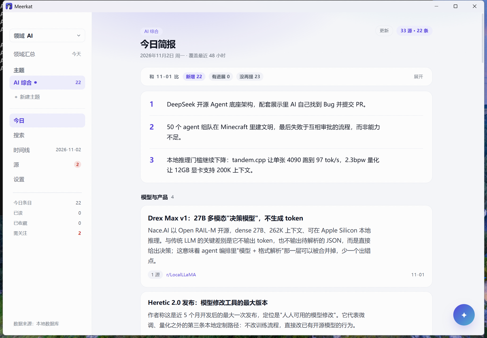
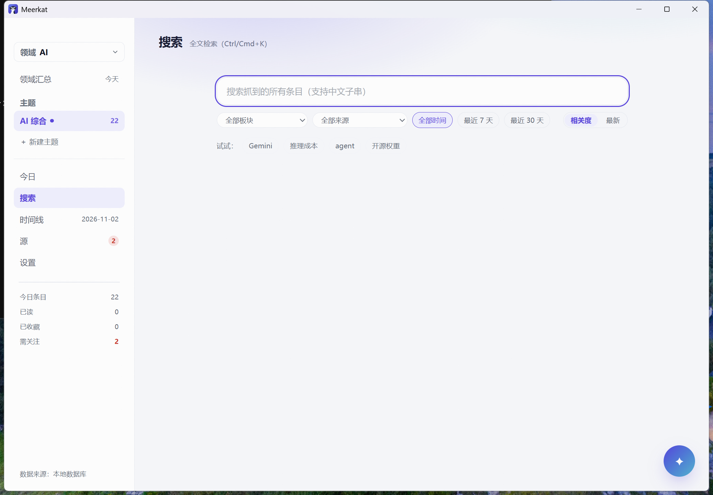
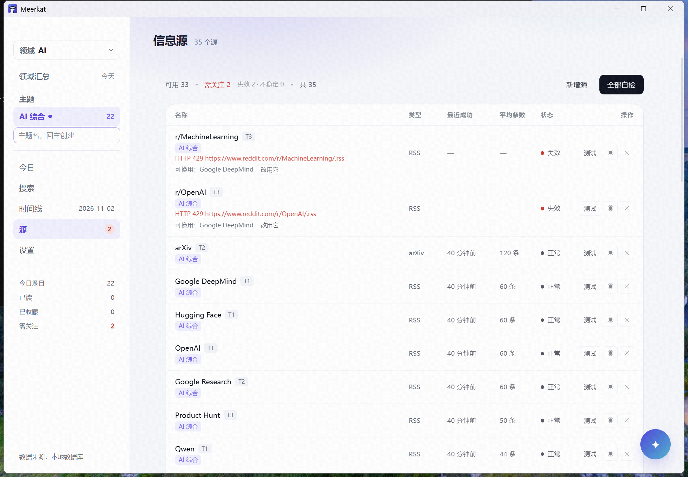
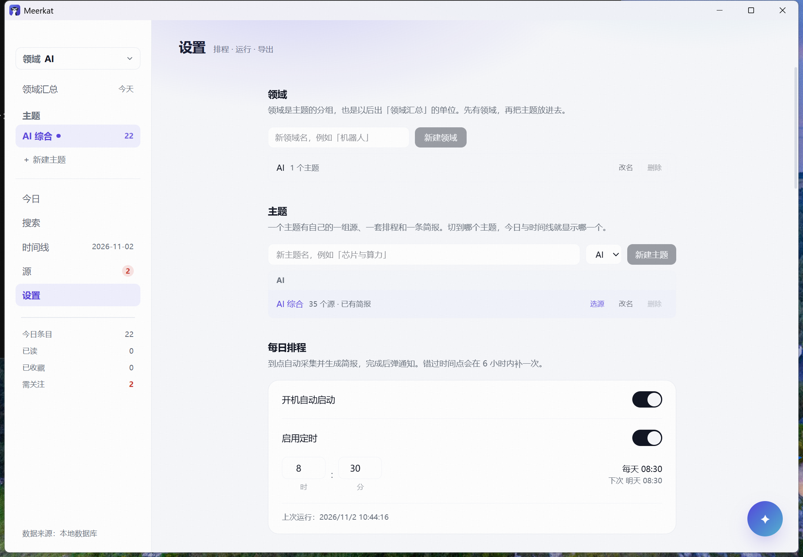
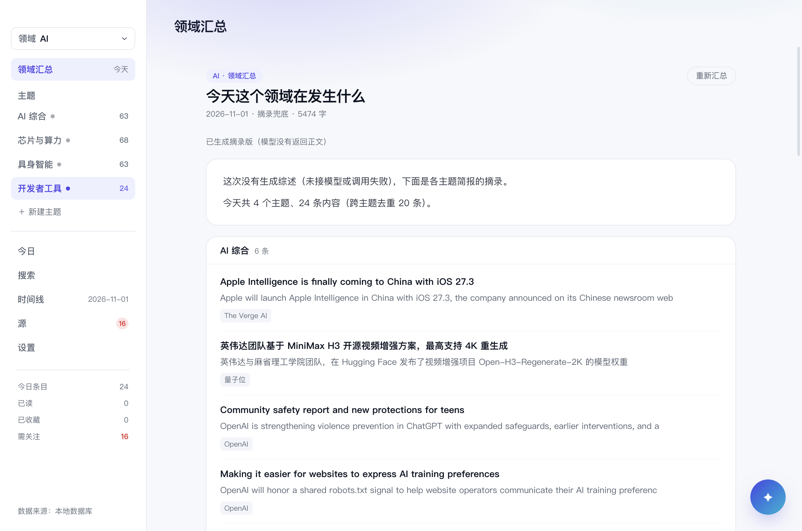
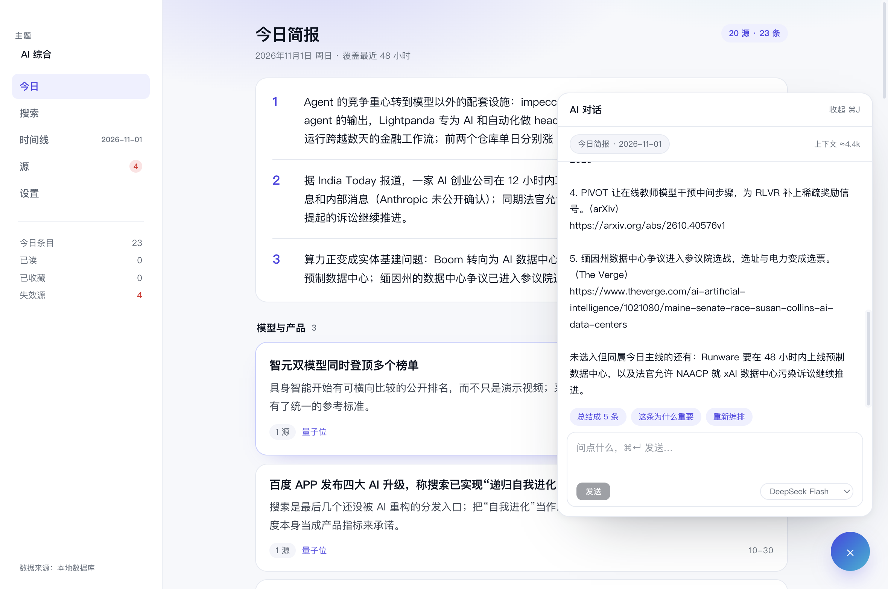

# 市场调研 + 真实使用审计

> 2026-11-02。方法：外部调研（公开报道与产品对比）+ 在本机用 v0.1.2 真实数据连续使用。
> 所有"用户痛点"都尽量挂到可复现的证据上（日志、数据库、截图），不写"我觉得"。

---

# 第一部分：市场

## 1. 这个产品到底在哪个赛道

不是"AI 新闻 App"，是 **personal change detection（个人化的变化监测）**。
用户要的不是更多信息，是"少看一点，但别漏掉重要的"。

四个相邻品类，各有各的强项与缺口：

| 品类 | 代表 | 强在哪 | 缺在哪 |
|---|---|---|---|
| **AI 日报邮件** | TLDR（报道称 800 万订阅、八位数收入）、Ben's Bites、The Rundown | 零配置、零成本、编辑过的判断 | 所有人看同一份；只讲"发生了什么"，不讲"和昨天比变了什么"；无法加自己的源 |
| **RSS + AI 阅读器** | Feedly AI、Inoreader、Readwise Reader、NetNewsWire、Reeder、NewsBlur、FreshRSS、Miniflux、Feedbin（[2026 横评](https://ttlab.hopto.org/blog/culture/2026-05-16-rss-readers-content-syndication-2026-feedly-ai-inoreader-netnewswire-reeder-5-newsblur-freshrss-miniflux-feedbin-readwise-reader-deep-dive?lang=en)） | 源完全可控、有全文、有搜索 | 你自己当编辑：几百条未读，没有"今天该看哪 15 条"的结论；没有跨天变化语义 |
| **大平台主动简报** | ChatGPT Pulse → **2026-06 关停**，改为 scheduled tasks（[报道](https://www.digit.in/news/general/openai-is-retiring-chatgpt-pulse-and-replacing-it-with-scheduled-tasks-here-is-why.html/amp/)） | 个人化、能连日历邮件 | 云端黑箱、不可控源、不可验证；且已经被官方判定方向不对 |
| **自建/极客方案** | RSSHub、changedetection.io、各种 `ai-news-radar` 脚本 | 免费、可魔改 | 要写代码、要维护、没有产品形态 |

## 2. 最重要的一条市场信号：Pulse 的失败

OpenAI 关掉 Pulse 时给的理由值得逐字读：

> "With Pulse, we learned that proactive experiences are most useful when they're **personalised, action-oriented, and steerable by the user**."

三个词就是这一品类的产品法则：

1. **personalised** —— 不是"AI 界的新闻"，是"我在意的变化"
2. **action-oriented** —— 看完要能做点什么（判断/决策/转发），不是看完更焦虑
3. **steerable** —— 用户能调：加源、调分寸、说"这条不重要"

Meerkat 在 (1) 和 (3) 上是结构性占优（本地、源自己管、领域/主题两层）；
**(2) 是最弱的一环**——现在的产物是"读完的简报"，不是"能做的事"。这是最大的产品缺口。

## 3. 竞品的共同空缺（Meerkat 的机会）

| 空缺 | 谁没做 | 难度 |
|---|---|---|
| **"和昨天比变了什么"作为一等公民** | 所有邮件简报都做不到（同一份发给所有人，没有你的昨天） | 已做，是护城河 |
| **源健康可见、可替换** | RSS 阅读器不告诉你"这个源三个月没产出" | 已做 |
| **本地优先、无账号** | 云产品结构性做不到 | 已做 |
| **任意领域，不只 AI** | 邮件简报都是垂类 | 已做（领域/主题） |
| **可以问"这条为什么重要"** | 简报是单向的 | 部分做了（AI 对话） |

## 4. 现实的威胁排序

1. **配置成本**：邮件简报 0 步，Meerkat 要选领域、加源、配 key、等第一次跑。**大多数人在这一步流失。**
2. **信任**：一次降级输出、一次 2/3 的链接校验失败，用户就不再相信"今日一句"。
3. **习惯**：每天打开的前提是**准时的提醒**——而通知是否真的弹出，至今没有肉眼验证过。
4. **分发**：两个平台都没签名；macOS 15+ 直接被 AMFI 拦。这不是"以后再说"的问题，是现在没人能装。
5. **依赖模型**：断网/欠费/模型下线，产品价值掉一半（虽然有降级，见下文）。

---

# 第二部分：真实使用审计

> 环境：v0.1.2，本机真实数据（35 源 / 1 领域 / 1 主题 / 126 条素材 / 3 份简报）。
> 旧版本在无人值守下连续跑了两天，日志见下。

## 0. 先说结论：它确实在无人值守下工作

```
11-01 00:30 UTC  定时触发（never-run）→ 33/35 源 · 136→80 条 · 26.0s
                 简报生成 deepseek-flash · 8298 字符 · 链接校验 31/31
11-02 00:30 UTC  定时触发（scheduled）→ 33/35 源 · 89→80 条 · 37.2s
                 简报生成 deepseek-flash · 7720 字符 · 链接校验 21/23
11-02 02:42 UTC  升级到 0.1.2 后首次启动 → 自动补跑
                 简报生成 6859 字符 · 链接校验 23/23
                 领域汇总（ai）· 1 个主题 · 6 条 · 已生成
```

**这是最有说服力的一件事**：它连续三天在自己跑，没人管。总耗时约 90 秒。

但也暴露了问题：**链接校验 21/23** 意味着模型给的两个链接对不上素材——用户看不到这件事。

---

## 1. 今日页（高频，每天看）



**好的地方**
- 对比条 `和 11-01 比 · 新增 22 · 有进展 0 · 没再提 23` 一眼抓住"变了什么"
- 三句话 + 分板块 + 今日一句，5 分钟能读完，密度合适
- 键盘 `j/k/s/o/m/h` 是真的能用，不是摆设

**问题**

| # | 问题 | 证据 | 影响 |
|---|---|---|---|
| 1.1 | **"有进展 0" 说明匹配过严** | 连续两期都是 0 | 最核心的差异点（"什么变了"）有一半失效；用户会觉得"每天都是全新的，没有连续性" |
| 1.2 | **链接校验失败在今日页不可见** | `BriefView.tsx` 里搜"降级/失败/degraded"命中 **0 处**；校验结果只写在时间线页（`TimelinePage.tsx:87`） | 用户点到 404 会归因于产品不可靠，而且无处查证 |
| 1.3 | **降级简报在阅读页完全没有提示** | 同上，0 处 | 模型挂了出的"仅聚合"版，看起来和正常简报一模一样 |
| 1.4 | **读完没有"结束"信号** | 无进度、无"今天看完了" | 5 分钟目标没有仪表盘，用户不知道还剩多少 |

## 2. 搜索页



**问题**

| # | 问题 | 证据 | 影响 |
|---|---|---|---|
| 2.1 | **占位文字被右边缘截断** | 实机截图："支持中文子串）"被切 | 明显的视觉 bug，第一印象打折 |
| 2.2 | **空状态是一大片白** | 实机截图 | 除了 4 个推荐词，没有任何"最近搜过""试试这个"的引导 |
| 2.3 | 筛选器与排序分两行且样式同类 | 截图中 `全部时间/最近7天/最近30天` 与 `相关度/最新` 视觉权重相同 | 用户分不清哪组是过滤、哪组是排序 |

## 3. 源页



**问题**

| # | 问题 | 证据 | 影响 |
|---|---|---|---|
| 3.1 | **两个 Reddit 源同时 429** | 日志与界面都是 2 个失败 | 35 源里 2 个死（5.7%），且都是高价值源 |
| 3.2 | **统计行标点错乱** | 实机："可用 33 ·  需关注 2  失效 2 · 不稳定 0 · 共 35" | 读起来像 bug，实际是拼接少分隔符 |
| 3.3 | **启用开关在 10px 下几乎看不出状态** | `◉` / `○` 两个字符，有 tooltip 但视觉差异极弱 | 用户不敢点，怕误关 |
| 3.4 | **每行都挂一个"AI 综合"主题 chip** | 35 行重复 35 次 | 单主题时是纯噪声；多主题时才有信息量 |
| 3.5 | **删除源用的是原生 `window.confirm`** | `SourcesPage.tsx:250`、`DomainManager.tsx:48`、`TopicManager.tsx:74` | 系统级灰色弹窗，与整体视觉断裂，且不可撤销 |

## 4. 设置页



**问题**

| # | 问题 | 证据 | 影响 |
|---|---|---|---|
| 4.1 | **"AI 1 个主题"缺分隔** | 实机截图 | 歧义：是"AI 有 1 个主题"还是"AI1"？ |
| 4.2 | **建主题有三个入口** | 侧栏「＋ 新建主题」、设置页表单、主题行「选源」 | 入口多是没想清楚，不是能力 |
| 4.3 | **设置页很长且无锚点导航** | 领域/主题/排程/模型/密钥/导出/反馈/关于 全在一页 | 找"换 key"要滚很久 |

## 5. 领域汇总（降级时质量崩塌）



这张图是全篇最重要的证据。

模型没返回正文时，兜底稿是这样的：

```
已生成摘录版（模型没有返回正文）
这次没有生成综述（未接模型或调用失败），下面是各主题简报的摘录。

Apple Intelligence is finally coming to China with iOS 27.3
Apple will launch Apple Intelligence in China with iOS 27.3, the company announced on its Chinese newsroom web

Community safety report and new protections for teens
OpenAI is strengthening violence prevention in ChatGPT with expanded safeguards, earlier interventions, and a
```

**问题**

| # | 问题 | 影响 |
|---|---|---|
| 5.1 | 兜底稿是**未翻译的英文标题 + 截断到一句话** | 中文用户读不了；截断处还在句子中间 |
| 5.2 | 兜底时没有任何"这是降级稿，质量会差"的醒目提示 | 只有一行小字，用户会以为产品就这水平 |
| 5.3 | 同一天侧栏 `需关注 16` | 16 个源不健康时，汇总质量必然差，但两者没有关联提示 |

**承诺是"不会开天窗"，但天窗是开着的，只是贴了张报纸。**

## 6. AI 对话



| # | 问题 | 影响 |
|---|---|---|
| 6.1 | 非流式，一次返回 | 等 20 秒没有任何反馈，用户会以为卡死 |
| 6.2 | 上下文只带当天简报 | 问"上周 Gemini 怎么样"答不了 |
| 6.3 | 无法把对话结论写回简报 | 问答完就散了，不沉淀 |

## 7. 跨页面的系统性问题

| # | 问题 | 说明 |
|---|---|---|
| 7.1 | **失败全部静默** | 源失败、链接校验失败、降级、汇总兜底——都只在次要页面露一行，或干脆不说 |
| 7.2 | **没有"第一次"的引导** | 新用户进来看到空简报，不知道要等 90 秒 |
| 7.3 | **通知未验证** | 每天 08:30 的钩子没被证明过，整个习惯链路悬空 |
| 7.4 | **没有更新机制** | 0.1.1→0.1.2 要用户自己下载重装 |
| 7.5 | **中文产品但兜底稿是英文** | 源里大量英文标题，失败时直接漏给用户 |
| 7.6 | **危险操作没有撤销** | 3 处原生 confirm，确认即删，删完不可恢复 |

---

## 补充说明（我核对代码后修正的两处判断）

写初稿时我判断"链接校验结果用户看不到""那个圆点按钮没有说明"，核对源码后需要修正：

- **链接校验不是完全看不到**，它写在时间线页（`TimelinePage.tsx:87`：`链接校验 21/23`）。
  真实问题是**位置不对**：用户是在今日页读的时候发现链接点不开，而去时间线页才能查证。
- **圆点按钮有 tooltip**（`title={s.enabled ? '停用' : '启用'}`），也在 `◉/○` 之间切换。
  真实问题是**10px 字号下两个字符几乎一样**，必须悬停才知道。

保留这两条，但理由改成"位置/可辨识度"，而不是"没有"。

---

# 第三部分：优化优先级

按「用户流失风险 × 修复成本」排。

## P0（这周就该做，否则产品不成立）

| 优先级 | 事项 | 为什么 | 验收标准 |
|---|---|---|---|
| **P0-1** | **兜底稿说人话** | 降级时英文截断稿 = 用户第一次遇到故障就再也不来了 | 兜底时输出中文摘要（哪怕规则式："OpenAI 发布安全报告，涉及青少年保护"），并明确标注「降级稿」 |
| **P0-2** | **让"有进展"真的能命中** | 连续两期为 0，等于核心卖点失效 | 用真实两期数据回归：至少命中 1 条，并给出"为什么算同一件事"的说明 |
| **P0-3** | **失败可见** | 链接 21/23、源 429、汇总兜底，用户都不知道 | 今日页报头下加一行状态："本次 2 条链接未校验通过 · 2 源失败 · 查看"，降级时整页顶部一条提示 |
| **P0-4** | **验证通知** | 没有提醒就没有每日习惯 | 装包后到点真的弹 toast（人眼确认） |

## P1（下个版本）

| 优先级 | 事项 | 验收标准 |
|---|---|---|
| P1-1 | 读完的"结束感"：进度条 + 读完后一句"今天看完了，5 分钟" | 读完最后一条有明确收束 |
| P1-2 | 搜索空状态 + 占位截断修复 | 输入框文字不被切；空状态给"最近搜过" |
| P1-3 | 源页：统计行标点、开关改成文字/明显图标、单主题时不显示 chip | 截图核对三处 |
| P1-4 | 设置页加左侧锚点导航 | 一屏内能跳到"模型与密钥" |
| P1-5 | 对话流式输出 | 首字 < 1.5 秒 |
| P1-6 | Reddit 429 的系统性处理 | 改用 RSSHub 镜像或标记"已知限流"并自动降频 |
| P1-7 | 删除改成应用内确认 + 5 秒撤销 | 去掉 3 处 `window.confirm` |

## P2（做完 P0/P1 再谈）

| 优先级 | 事项 | 说明 |
|---|---|---|
| P2-1 | **action-oriented**：把"读完"变成"做完" | Pulse 的教训。例：一键生成"周会可说的三句"、一键对比某主题两周变化 |
| P2-2 | 对话结论写回简报 | 问答不该是死路 |
| P2-3 | 自动更新 / 签名 | 分发前提 |
| P2-4 | 多语言源的中文化兜底 | 目前只有模型能翻，模型挂了就没 |
| P2-5 | 首次启动的"等 90 秒"体验 | 进度、预估时间、可取消 |

---

# 一句话总结

**产品方向是对的，护城河（跨天对比 + 源健康 + 本地）也是真的；
但"降级时很难看"和"失败不说话"这两件事，会在用户第一次遇到故障时把信任一次性花光。**

先把兜底稿做成人能读的东西，再谈惊艳。
