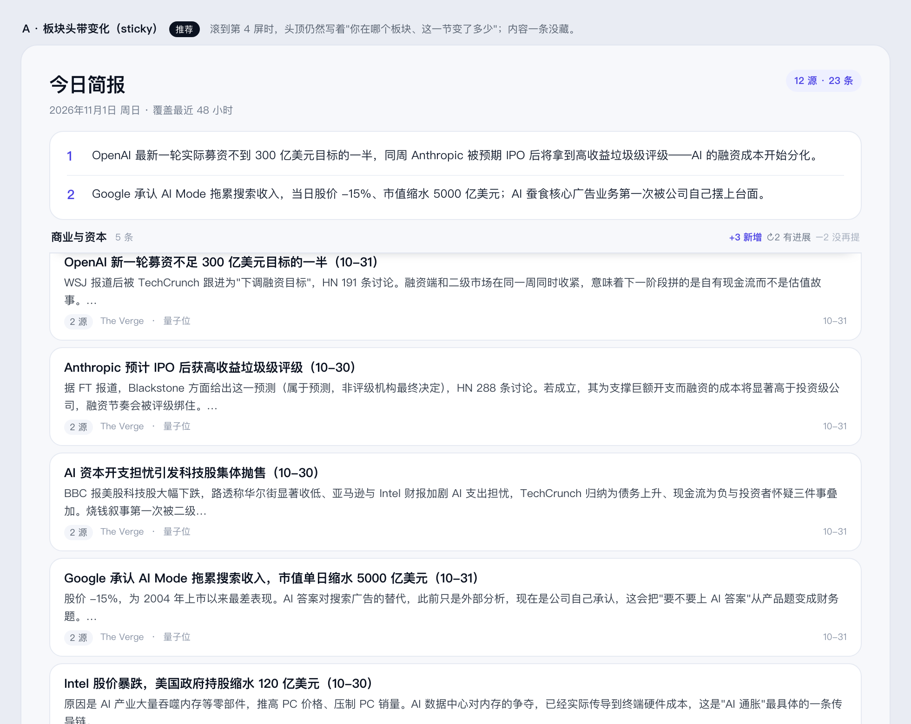
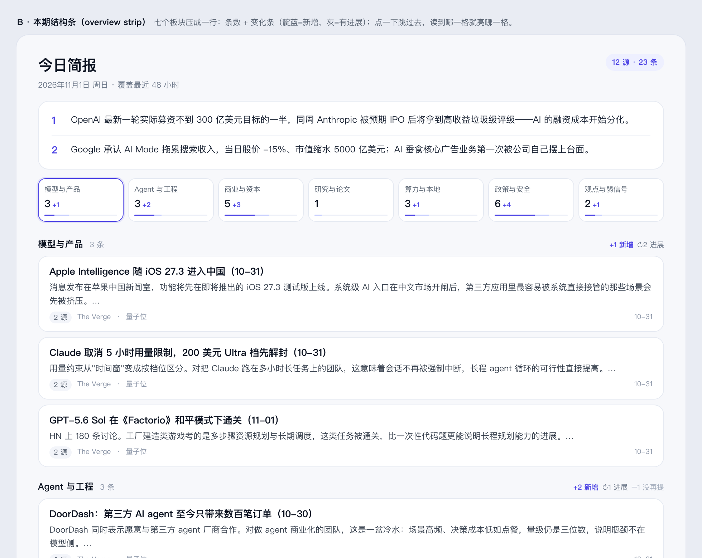
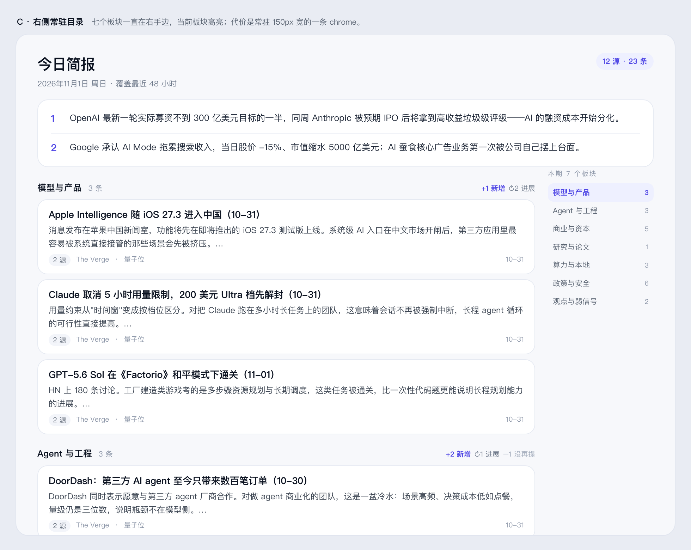
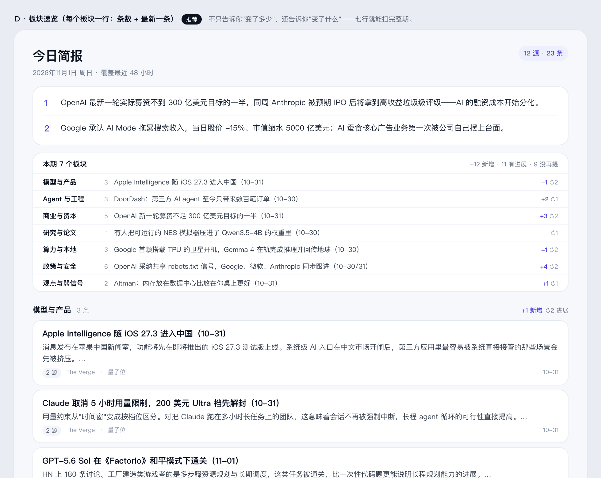
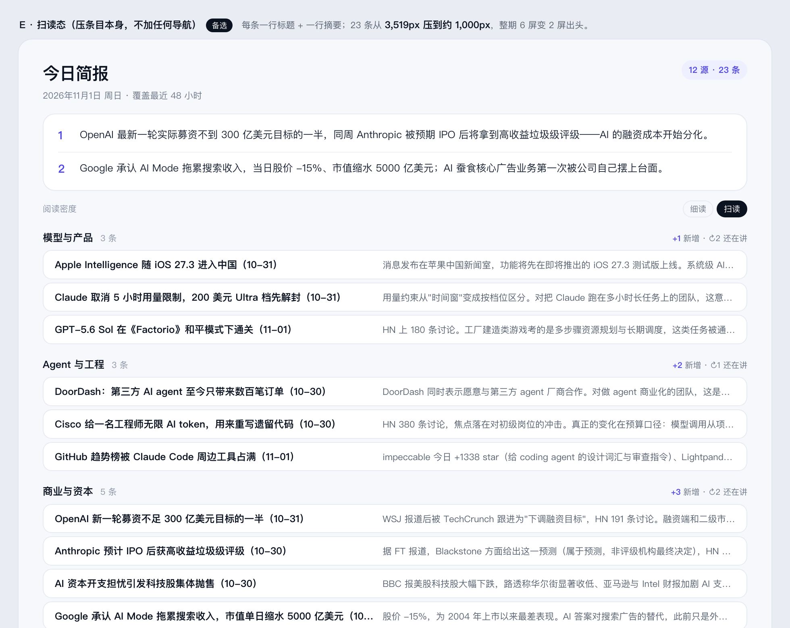
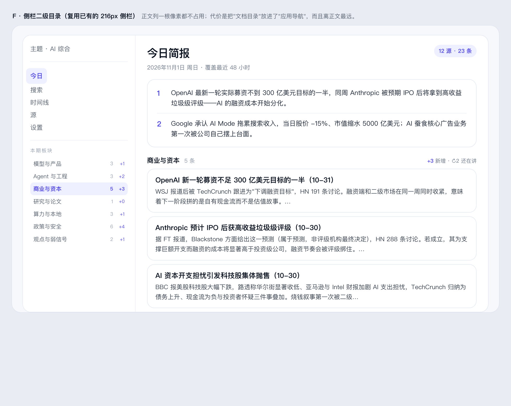
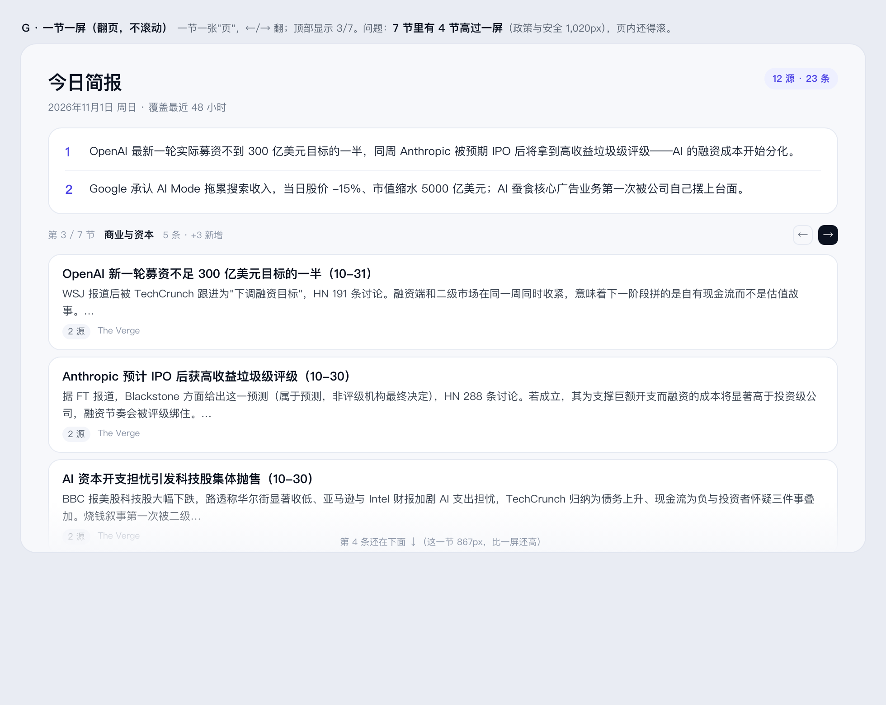
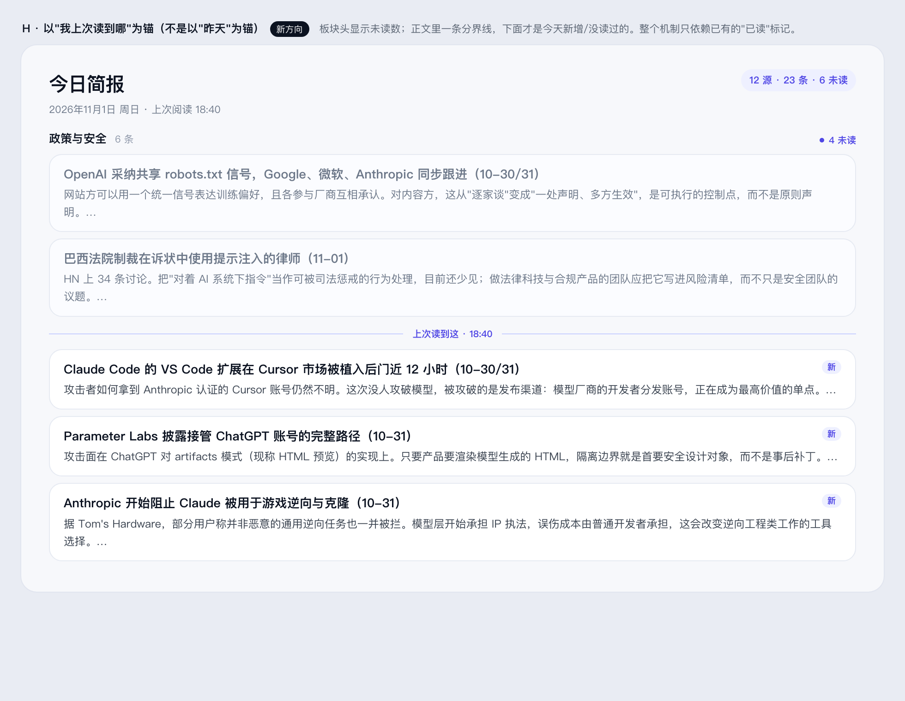
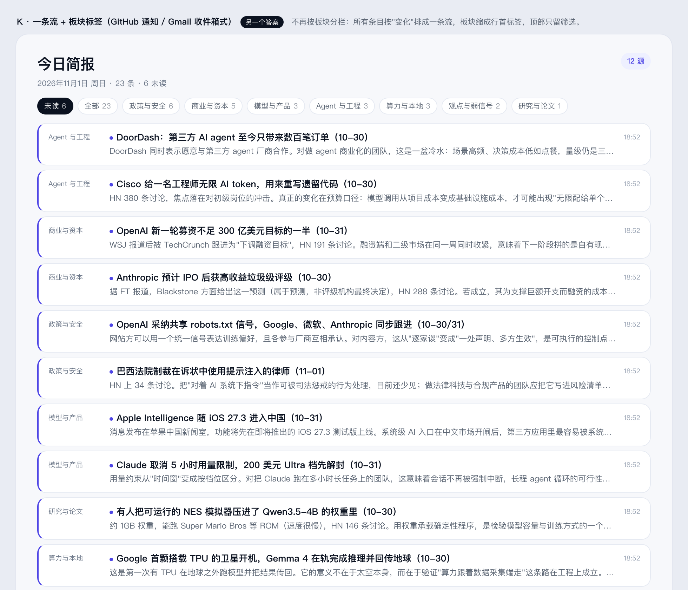

# 多板块简报：怎么让人一眼看到每个板块的变化

> 2026-11-01 · 调研 + 设计草稿，**未落地**
> 触发：一个领域有 7 个板块、23 条，滚到第 3 屏就不知道自己在哪一节了，也没法在开头判断"今天哪一节值得看"。

## 一、先把问题量出来

拿真实的 `AI简报-2026-11-01.md` 在应用里量：

| | |
|---|---|
| 板块数 / 条目数 | 7 / 23 |
| 内容总高 / 视口 | 4,745px / 783px → **约 6 屏** |
| 七个板块头的 y 坐标 | 406 / 918 / 1,478 / 2,345 / 2,574 / 3,085 / 4,105 |
| 最长的一节 | 政策与安全 1,020px（6 条） |

现状只有两种"结构信息"：

1. 每个板块头一行小灰字 `模型与产品 3`，10.5px，滚过去就没了；
2. 顶部的"和昨天比"条给的是**全站**三个数（新增/有进展/没再提），不落到板块。

所以"一眼"失败在两点：**看不见全局结构**（哪几节、各多少条），**看不见每节的变化**（哪节是新的、哪节没动）。

## 二、判断标准（先定，再看方案）

调研后我把标准收成五条，后面每个方案都按这个打分：

1. **概览优先，细节按需** —— 先给"地图"，再给正文（Shneiderman 的老规矩）。
2. **不要为了少滚动而藏内容** —— [NN/g 对 accordion 的结论](https://www.nngroup.com/articles/accordions-complex-content/)很明确：读者需要看完整页内容时，折叠是在收"点击税"，长页面本身不是问题。
3. **每个入口要有信息气味** —— [information scent](https://www.nngroup.com/articles/information-scent/)：光写"3 条"不够，得让人看出里面大概是什么。
4. **变化数字必须带比较基准** —— [delta indicator](https://patterns.konigi.com/dashboards/delta-indicator)：`+3` 不写"比什么"就不是事实；另外**颜色不能只编码涨跌**，要编码好坏（我们这里是"新增/有进展/没再提"，不涉及好坏，所以用中性色 + 文字）。
5. **小集合上别造层级** —— [overview-then-detail](https://patterns.konigi.com/dashboards/overview-then-detail) 里那句话值得抄下来：*"There are six things. A hierarchy over a small set is ceremony."* 七个板块做一套 drill-down 是仪式，不是功能。

## 三、七种做法，逐个判

| 做法 | 参考 | 代价 | 对这个产品 |
|---|---|---|---|
| 折叠板块（默认收起没变化的） | 邮件摘要、Notion | 多一次点击；藏起来的可能永远不被读 | ❌ 违反第 2 条：这份东西就是要被读完的 |
| **粘性板块头**（滚到哪节，头就停在哪） | 长文档、[NN/g sticky headers](https://www.nngroup.com/articles/sticky-headers/) | 每节多 30px 常驻 | ✅ 成本最低，解决"我在哪" |
| **顶部结构条**（7 格：名称+条数+变化条） | 仪表盘的 KPI 条 | 60px；只给量不给内容 | ⭕ 能用，但气味弱（第 3 条） |
| **板块速览表**（7 行：名称+条数+最新一条+变化） | 报纸目录、TLDR 类摘要 | 170px 首屏 | ✅ 一句话回答"变了什么" |
| 右侧常驻目录 / 轨道 | 文档站 TOC、代码 minimap | 150px 常驻 chrome + 正文变窄 | ❌ 七项做轨道是第 5 条说的仪式 |
| 两栏"首页"排版 | 报纸头版 | 阅读顺序被打断，键盘流要重做 | ❌ 与 5 分钟线性读完冲突 |
| 板块级 7 日 sparkline | 仪表盘 signature chart | 需要历史数据 | ⏸ 现在库里只有 1 期，做不了 |

## 四、四张草稿

数据说明：库里只有 2026-11-01 一期，**变化数字是样例**（按真实分布编的），用来判断版式，不是真实对比。

### A · 粘性板块头（改造成本最低）



滚到第 4 屏时，头顶仍然写着"商业与资本 · 5 条 · +3 新增 · ↻2 有进展"。
不改内容、不加跳转、不加高度——只是把原来那行 10.5px 灰字变成一条会停住、带变化的头部。

### B · 顶部结构条（七格）



七个板块压成一行：条数 + 一条 2px 的变化条（靛蓝=新增，浅靛蓝=有进展）。点一下跳过去，滚动时高亮当前格。
好处是全局一眼；弱点是**只有量，没有内容**——看不出来"政策与安全"那 6 条讲的是什么。

### C · 右侧常驻目录



七个板块一直在右手边，当前高亮。信息最全，但它常驻 150px，正文列从 780 收到 700，行长明显变短；
而且它和"顶部结构条"是同一件事的两种画法，二选一即可。

### D · 板块速览表（每个板块一行）



`板块名 · 条数 · 最新一条标题 · +新增 ↻进展`。七行，170px，扫一眼就知道**哪一节变了、变成什么**。
这是唯一同时满足第 1 条（概览）和第 3 条（气味）的做法——因为标题本身就是气味。

## 五、建议

**D + A，两个都做，一起才是完整的。**

- **D 在最上面**（三句话卡之下、正文之上）解决"一眼看到全局和每节的变化"；
- **A 在正文里**解决"读到第 4 屏时我在哪、这节变了多少"；
- 两者共用同一份数据（下面说），不重复造轮子。

落地要点：

1. **数据已经够了**。`compareBriefs()` 返回的 `added / carried / dropped` 每条都带 `section` 字段（`CompareEntry.section`），按板块聚合是纯前端工作，**不用改后端**。
2. **两种状态都要设计**：
   - 有上一期：显示 `+n ↻n`；
   - 没有上一期（首期、断档、只有 1 期）：**不显示 0**，只显示条数 + 最新标题。今天的库就处于这个状态。
3. **D 的折叠**：默认展开（首屏仍有第一条可见），读完后可收起成一行 `本期 7 个板块 · +12 新增`。
   注意这属于 progressive disclosure，收起态必须自带信息（第 2 条标准）。
4. **键盘**：`j/k` 跨板块时，粘性头跟着换；建议顺手加 `[` `]` 直接跳上/下一节（D 的每一行也是跳转锚点）。
5. **不要做的事**：折叠板块正文、右侧轨道、把 seven sections 做成二级页面。

## 六、还没验证 / 风险

- **首屏成本**：D 占 170px，第一条正文从 y≈430 移到 y≈490，仍在 783px 视口内——但这是用草稿量的，真机要塞进 React 再看一次。
- **板块数会变**：prompt 允许模型调整板块，最多可能有 8–10 节。D 在 10 行时会到 ~250px，需要定一个上限（比如只显示前 8 行 + "还有 N 节"）。
- **变化语义**：`carried`（有进展）在简报里不一定真的"有进展"——判定是标题/URL 相似。措辞上建议用"还在讲"而不是"有进展"，避免过度承诺（这一点和 `CompareStrip` 现在的文案不一致，值得统一）。
- **样例数据**：四张图的 `+n` 是编的，不能作为真实分布的判断依据。


## 七、另外三个方向（E / F / G）

前面 A–D 都在"给内容加一层结构提示"。下面三个换了轴：**压内容本身 / 借用既有空间 / 换阅读模型**。

### E · 扫读态：压条目，不加任何导航



实测单条卡片平均 **153px**（144–192），23 条光条目就 **3,519px**。压成"一行标题 + 一行摘要"约 44px：

| | 现在 | 扫读态 |
|---|---|---|
| 23 条条目 | 3,519px | ≈1,012px |
| 整期内容 | 4,745px | ≈1,900px（约 2.4 屏） |

一屏能同时看到 3 个板块、12 条——"每个板块在发生什么"变得可以直接扫。
代价：正文从两三行缩成一行，原来的"解读"要展开才读得到。

**适合做成模式**：默认扫读，`Enter` / 点击某条展开成完整卡片。这样它同时是"一眼看结构"和"细读"的入口。

### F · 侧栏二级目录：复用已有的 216px



侧栏已经有 216px 宽，加七行"板块 · 条数 · 变化"就够，**正文列一个像素都不占**。
代价有两个：把"文档目录"混进了"应用导航"（两个层级的东西挤在一列）；而且它在最左边，离正文最远，眼睛要横跨整屏。

另外侧栏在 520px 最小窗口高度下已经比较满，加七行需要实测会不会顶掉底部状态行。

### G · 一节一屏：翻页，不滚动



一节一张"页"，←/→ 翻，顶部显示 3/7。听起来最"克制"，但量出来的数据不支持：

| 板块 | 高度 | 一屏（≈600px 内容高度）放得下？ |
|---|---|---|
| 研究与论文 | 229px | ✅ |
| 算力与本地 | 511px | ✅ |
| 模型与产品 | 512px | ✅ |
| Agent 与工程 | 560px | 勉强 |
| 观点与弱信号 | 640px | ❌ |
| 商业与资本 | 867px | ❌ |
| 政策与安全 | 1,020px | ❌ |

**7 节里 4 节高过一屏**，翻页之后页内还要滚——只多了一个模式，没减少滚动。不做。

### 阶段性判断（被第八节修正，保留以便看思路怎么变的）

三个方向里只有 **E** 值得认真考虑，因为它可能让 D 变得多余：

- **想保住现在的阅读手感** → 还是 **D + A**；
- **愿意用密度换"一眼"** → **E（默认扫读、点开细读）+ A**，A 在扫读态下更重要（一屏三条，更容易迷失）；
- **F** 只在"绝对不想让正文变矮"时作为 D 的替代；**G** 不做。


## 八、更广的调研：13 个领域，15 种机制

E/F/G 之后又把范围拉开，看别的领域怎么处理"一屏装不下、但必须一眼看懂"的信息。

| 领域 | 典型产品 | 机制 | 优化什么 | 对本品 |
|---|---|---|---|---|
| 论坛 / 协作 | Slack、Discourse | **上次访问线**（"new since you were here"） | 变化（相对于*你*） | ✅ 见 H |
| 邮件客户端 | Gmail、Superhuman | 未读徽标、按会话聚合 | 变化（相对于*你*） | ✅ H 的变体 |
| RSS 阅读器 | Reeder、NetNewsWire | 每个订阅源的未读数、智能文件夹 | 变化（相对于*你*） | ✅ |
| 代码编辑器 | VS Code、Zed | 大纲面板、minimap、breadcrumb | 结构 + 位置 | ⭕ 大纲 = 侧栏 F；minimap = 标注滚动条 |
| 文档站 | MDN、Stripe Docs | 右侧目录 + 滚动高亮 | 结构 | ⭕ = C |
| 新闻 App | NYT、Apple News、NOS | 板块首页、卡片层级、头条放大 | 一眼 | ❌ 版面成本太高 |
| Newsletter | TLDR、Morning Brew | "本期目录" + 每条一句话 | 信息气味 | ✅ = D |
| 仪表盘 | Grafana、Datadog | delta 徽标、异常高亮 | 变化（量） | ⭕ D 的数字部分 |
| 金融终端 | Bloomberg | 极高密度 + 功能键 + 分层披露 | 专业用户吞吐 | ❌ 学习成本 |
| 电子书 | Kindle | 进度条 + 章节标记 | 位置 | ⭕ = 粘性头 A |
| 学术可视化 | 语义缩放 / overview+detail | 缩放即换粒度 | 结构 | ❌ 过度设计 |
| 音频简报 | Briefcase 之类 | 把"读五分钟"变成"听三分钟" | 时间 | ⭕ 另一个表面，不是版式问题 |
| 长文档研究 | NN/g 眼动研究 | F 型扫描、前 20% 注意力 | 阅读行为 | 用来定标准 |

三个机制族：

1. **结构**（目录 / 大纲 / minimap / 粘性头 / 标注滚动条）——解决"这份东西长什么样、我在哪"；
2. **变化**（delta 徽标 / 未读 / 上次访问线 / 只看变化）——解决"哪里动了"；
3. **密度与模态**（扫读态 / 导语 / 音频）——解决"我要读多少、用什么读"。

### 一个被这轮调研推翻的判断

前面 D 的"变化"是按**日**算的（今天 vs 昨天）。但 Slack / Discourse / Gmail / RSS 这些每天要被打开很多次的产品，几乎都不用"日"做基准，而是用**"你上次读到哪"**：

> "above this line: topics that are new or updated since your last visit" —— [Discourse 的实现讨论](https://meta.discourse.org/t/show-updated-topics-above-this-line-in-the-topic-list/48641)

这不是审美选择，是成本选择：日对比需要两期简报（今天的库里只有 1 期，所以什么都显示不出来），而"上次读到哪"只需要**已有的已读标记**。

同一个讨论串里还有两个真实的坑，值得抄作业时避开：

- 线什么时候移动？Discourse 的答案是"离开一小时算一次访问结束"，否则线会乱跳；
- 线不该在刷新后还停在那里不动——用户会以为它坏了。

### H · 以"我上次读到哪"为锚



- 板块头：`政策与安全 · 6 条 · ● 4 未读`；
- 正文里一条分界线：`上次读到这 · 18:40`，线下才是新增/没读过的；
- 未读条目右上角一个"新"。

数据全部来自现有的 `useFlags`（已读/收藏就是它），**不需要改后端，也不需要等第二期简报**。

### 第二版判断（被第九节再次修正）

- **变化用 H**：每节未读 + 上次读到这。它今天就能用，而且比"日对比"更贴近"我回来看看变了什么"。
- **结构用 A + D**：粘性头负责"我在哪"，D 的速览负责"整体长什么样"；D 里的数字优先放**未读**，有上一期时再补 `+新增`。
- **E（扫读态）** 与上面正交，可以晚点做。
- **不做**：C（右侧轨道）、G（翻页）、newsletter 式的整页重排。


## 九、市场怎么展现："很多类 + 要看变化"

前面 A–H 都在**保留七个板块**的前提下想办法。把市场上真要每天打开的 app 摆出来，会发现它们基本不这么做。三种范式：

| 范式 | 谁 | 屏幕上实际长什么样 | 为哪种行为设计 |
|---|---|---|---|
| **单流 + 筛选** | GitHub 通知、Gmail 收件箱、Slack、Apple News 的 Today | 一个列表，按变化/时间排；分类变成行首标签或顶部 filter；未读是点或加粗 | 每天回来"看变了什么" |
| **一句话摘要** | TLDR、Morning Brew、NYT The Morning | 分类并列，但每条压到一句话；一封看完 | 5 分钟读完 |
| **板块首页** | NYT 的版块页、Apple News 的频道、门户 | 每个板块一屏，头条放大、卡片层级 | 逛、找兴趣，不是"看变化" |

关键区别：**前两种是给"每天看变化"设计的，第三种是给"浏览"设计的。**
Meerkat 现在的形态是第三种（七个板块各占半屏到一屏），但用户的动作是第一种。

### K · 一条流 + 板块标签



同一份内容、同样的排版语言，只是不再按板块分栏：

- 每条 = `板块标签 · 标题 · 一句摘要 · 时间`，未读左边一条靛蓝细线 + 标题前一个点；
- 顶部只有筛选：`未读 6 / 全部 23 / 政策与安全 6 / 商业与资本 5 …`，每个 chip 自带数量；
- 排序默认"变化优先"（未读、新出现的在前），而不是板块顺序。

密度对比：现在的卡片**一屏 3 条**，这个形态**一屏 11 条**。

会丢掉的东西：板块是编辑对世界的切分，分栏本身在讲故事。补偿办法是把叙事集中到顶部的"三句话"，
而不是靠七个小标题暗示。

## 十、最终建议

把前面九节压成一句话：**问题不在"七个板块怎么摆"，在"为什么要把七个板块并排摆"。**

- **形态换成 K**：一条按变化排序的流，板块退成行首标签和顶部筛选。这是市场里"每天看变化"的主流形态（GitHub / Gmail / Slack），密度从一屏 3 条变成一屏 11 条。
- **"新"用 H**：未读点 + 上次读到这的分界线。只依赖已有的已读标记，今天就能用。
- **叙事留在三句话**：板块被拆掉之后，编辑的判断要由顶部那三条承担，而不是七个小标题。
- **A（粘性头）** 在 K 里不需要了——没有板块栏就没有"我在哪一节"。
- **D（速览表）** 降级为可选的"本期概览"，有上一期数据时才有意义。

## 资产

```
docs/section-research/
├── a-sticky.png / .html   粘性板块头（模拟"滚到第 4 屏"）
├── b-strip.png  / .html   顶部七格结构条
├── c-rail.png   / .html   右侧常驻目录
├── d-index.png  / .html   板块速览表
├── e-scan.png   / .html   扫读态（压条目）
├── f-sidebar.png / .html  侧栏二级目录
├── g-pages.png  / .html   一节一屏（已否）
├── h-lastread.png / .html 上次读到这（新方向）
└── k-stream.png  / .html 一条流 + 板块标签
```
